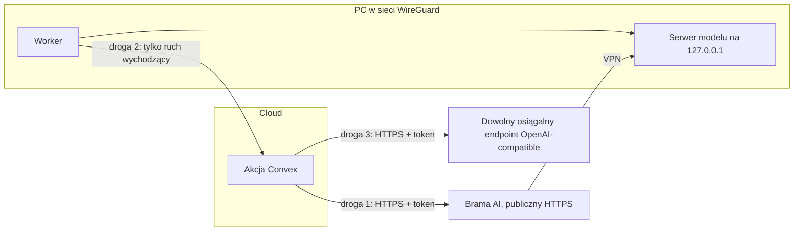

# Dostawcy AI

Wszystkie wywołania modeli idą przez akcje Convex (`convex/notes/actions.ts` jest przykładem). Akcje mogą wołać `fetch`, a zapytania i mutacje nie, według [dokumentacji Convex o środowiskach uruchomieniowych](https://docs.convex.dev/functions/runtimes). Frontend nie rozmawia z modelem i nie widzi klucza. Kod warstwy AI: `convex/ai/`.

## Wybór dostawcy i zmienne

Dostawcę wybierasz wyłącznie zmienną środowiska wdrożenia Convex ([dokumentacja](https://docs.convex.dev/production/environment-variables)), osobno dla każdego wdrożenia (dev, preview, prod):

```bash
npx convex env set AI_PROVIDER mock
npx convex env set AI_PROVIDER openai-compatible
```

| Zmienna              | Domyślnie     | Opis                                                                                                                                                               |
| -------------------- | ------------- | ------------------------------------------------------------------------------------------------------------------------------------------------------------------ |
| `AI_PROVIDER`        | `mock`        | `mock` albo `openai-compatible`. Puste i brak oznaczają `mock`.                                                                                                    |
| `AI_BASE_URL`        | brak          | Wymagana dla `openai-compatible`. Tylko `https`; `http` wyłącznie dla `localhost` i `127.0.0.1`. Adres z `user:hasło@` jest odrzucany. Zwykle kończy się na `/v1`. |
| `AI_MODEL`           | brak          | Wymagana dla `openai-compatible`. Nazwa modelu na serwerze.                                                                                                        |
| `AI_API_KEY`         | brak          | Wymagana dla `openai-compatible`. Token wysyłany jako `Authorization: Bearer`. **Sekret.**                                                                         |
| `AI_TIMEOUT_MS`      | `20000`       | Limit jednej próby, liczba całkowita od 1 do 120000.                                                                                                               |
| `AI_MAX_RETRIES`     | `1`           | Liczba powtórzeń, od 0 do 3.                                                                                                                                       |
| `AI_STRUCTURED_MODE` | `json_schema` | `json_schema`, `json_object` albo `prompt` (tabela niżej).                                                                                                         |

Klucze trafiają tylko do środowiska Convex. Nigdy do zmiennych `VITE_*` (wpadają do paczki przeglądarki) ani do `.env.local`. Konfiguracja jest parsowana przy wywołaniu akcji, nie przy starcie modułu, więc błędna zmienna daje błąd `config` tylko w tej akcji, a reszta aplikacji działa. Komunikaty o błędach konfiguracji nie zawierają wartości zmiennych.

## Dostawca `mock`

Domyślny, bez klucza i sieci. Jest deterministyczny (to samo wejście daje ten sam wynik), więc służy testom, demo i jako siatka bezpieczeństwa: gdy prawdziwy model zawiedzie na scenie, jedno polecenie wraca do `mock`.

Scenariusze wybiera początek promptu:

| Prefiks promptu  | Efekt                                                                          |
| ---------------- | ------------------------------------------------------------------------------ |
| `[mock:error]`   | błąd `unavailable` (ponawiany)                                                 |
| `[mock:timeout]` | błąd `timeout` (ponawiany)                                                     |
| inny             | `generateText` zwraca polskie podsumowanie z liczbą znaków i początkiem tekstu |

Wynik strukturalny to gotowy fixture przypisany do `schemaName` (dla notatek: `notesSummary`) i zwalidowany schematem. Nieznane `schemaName` daje błąd `config`.

## Dodanie własnego dostawcy

1. Zaimplementuj interfejs `AIProvider` z `convex/ai/types.ts`: `generateText`, `generateStructuredOutput`, `getProviderInfo`. Błędy zgłaszaj jako `AIProviderError` z kodem (`config`, `timeout`, `unavailable`, `auth`, `rate_limited`, `bad_response`) i flagą `retryable`.
2. Dodaj wariant do schematu w `convex/ai/config.ts` i gałąź w `getProvider` (`convex/ai/index.ts`).
3. Napisz testy z podstawionym `fetch`. Testy nie używają sieci ani prawdziwego modelu.

Cała warstwa `convex/ai/**` to plik wspólny: zmiana idzie w osobnym PR (patrz [architecture.md](architecture.md)). Między prawdziwymi dostawcami nie ma automatycznego przełączania: gdy model zawiedzie, akcja zwraca typowany błąd, UI pokazuje „AI niedostępne”, a reszta aplikacji działa.

## Adapter OpenAI-compatible

Wysyła `POST {AI_BASE_URL}/chat/completions`. Odpowiedź jest walidowana Zodem pod kształt chat completions, inna daje `bad_response`. Gdy serwer zwraca `usage`, trafia do wyniku.

### Błędy i ponawianie

| Sytuacja                                               | Kod błędu      | Ponawiane?                                   |
| ------------------------------------------------------ | -------------- | -------------------------------------------- |
| 401, 403                                               | `auth`         | nie                                          |
| 429                                                    | `rate_limited` | tak (nagłówek `Retry-After` jest ignorowany) |
| 5xx, brak połączenia                                   | `unavailable`  | tak                                          |
| przekroczony `AI_TIMEOUT_MS`                           | `timeout`      | tak                                          |
| 404                                                    | `config`       | nie                                          |
| 400, 422 w trybie `json_schema` lub `json_object`      | `bad_response` | nie                                          |
| 400, 422 w trybie `prompt`, inne nieoczekiwane statusy | `bad_response` | nie                                          |
| odpowiedź nie jest JSON-em albo nie pasuje do schematu | `bad_response` | nie                                          |

Przerwa przed powtórzeniem to `500 ms × 2ⁿ`. Wnioski:

- Timeout też jest ponawiany, więc wolny model może zająć do `(AI_MAX_RETRIES + 1) × AI_TIMEOUT_MS` plus przerwy. Przy ustawieniach domyślnych to ok. 40 s, nie 20 s.
- Najgorszy możliwy przypadek jest ograniczony: `AI_TIMEOUT_MS ≤ 120000` i `AI_MAX_RETRIES ≤ 3`.
- 404 prawie zawsze znaczy, że w `AI_BASE_URL` brakuje `/v1`.
- 400 lub 422 przy `json_schema` albo `json_object` zwykle znaczy, że serwer nie obsługuje `response_format`: spróbuj `AI_STRUCTURED_MODE=json_object`, a potem `prompt`.

### Tryby strukturalne

Serwery różnie traktują ustrukturyzowane odpowiedzi, dlatego jest `AI_STRUCTURED_MODE`. W każdym trybie odpowiedź jest parsowana (`JSON.parse`, w trybie `prompt` po zdjęciu ewentualnego bloku markdown) i walidowana schematem Zod. Porażka daje `bad_response`.

| Tryb                     | Żądanie                                                                                                 | Znane wsparcie                                                                                                                                                                                                                                                                                                                                                                                          |
| ------------------------ | ------------------------------------------------------------------------------------------------------- | ------------------------------------------------------------------------------------------------------------------------------------------------------------------------------------------------------------------------------------------------------------------------------------------------------------------------------------------------------------------------------------------------------- |
| `json_schema` (domyślny) | `response_format: { type: "json_schema", json_schema: { name, schema } }`, schemat z `z.toJSONSchema()` | vLLM ([structured outputs](https://docs.vllm.ai/en/latest/features/structured_outputs/)), serwer llama.cpp ([README](https://github.com/ggml-org/llama.cpp/blob/master/tools/server/README.md)), Ollama: endpoint `/v1` mapuje `response_format` z `json_schema` ([kod](https://github.com/ollama/ollama/blob/main/openai/openai.go), [dokumentacja](https://docs.ollama.com/api/openai-compatibility)) |
| `json_object`            | `response_format: { type: "json_object" }` i schemat w prompcie systemowym                              | vLLM ([serwer OpenAI-compatible](https://docs.vllm.ai/en/latest/serving/online_serving/openai_compatible_server/)), Ollama                                                                                                                                                                                                                                                                              |
| `prompt`                 | sam schemat w prompcie systemowym                                                                       | każdy serwer                                                                                                                                                                                                                                                                                                                                                                                            |

Zacznij od domyślnego trybu i schodź w dół tylko przy błędach 400/422 lub `bad_response`.

## Bielik i PLLuM

Oba modele podłączasz tym samym adapterem, jeśli serwer wystawia `/v1/chat/completions`.

- **Bielik 11B v3.0 Instruct** (SpeakLeash): licencja Apache-2.0, repozytorium na Hugging Face wymaga zgody (gated). Karta modelu opisuje serwowanie przez vLLM (`vllm serve speakleash/Bielik-11B-v3.0-Instruct`, endpoint `/v1/chat/completions`), a także SGLang i Docker Model Runner ([karta modelu](https://huggingface.co/speakleash/Bielik-11B-v3.0-Instruct)).
  Są też buildy GGUF i model w Ollamie (`SpeakLeash/bielik-11b-v3.0-instruct`); SpeakLeash ostrzega, że wersje skwantyzowane tracą na jakości ([GGUF](https://huggingface.co/speakleash/Bielik-11B-v3.0-Instruct-GGUF)). Karta nie opisuje wywoływania narzędzi ani ustrukturyzowanych odpowiedzi. Zawsze polegaj więc na walidacji Zod i miej gotowy tryb `prompt`.
- **PLLuM** (CYFRAGOVPL): karty opisują serwowanie przez vLLM z endpointem zgodnym z OpenAI ([PLLuM-12B-chat](https://huggingface.co/CYFRAGOVPL/PLLuM-12B-chat), [PLLuM-12B-chat-2412](https://huggingface.co/CYFRAGOVPL/PLLuM-12B-chat-2412)). **Licencje różnią się między modelami**: Apache-2.0, CC-BY-NC-4.0 (warianty `-nc`, tylko użytek niekomercyjny) licencja Llama 3.1 albo inna, a część repozytoriów może wymagać zgody (gated). Przed użyciem w projekcie sprawdź kartę konkretnego modelu.

## Trzy drogi do modelu

Chmura Convex nie dosięgnie prywatnego adresu w sieci WireGuard, więc model na domowym PC wymaga jednej z trzech dróg:



1. **Brama (opisana, niezaimplementowana).** Mały reverse proxy z uwierzytelnianiem na osiągalnym hoście (VPS w sieci WireGuard albo produkt tunelujący) kończy TLS, sprawdza token, ogranicza ruch i przekazuje żądania do modelu przez VPN. Dla Convex to droga 3 z `AI_BASE_URL` wskazującym na bramę. Wymagania: TLS, token, limity rozmiaru i czasu żądań, brak bezpośredniego otwarcia portu modelu.
2. **Worker (opisana, niezaimplementowana).** Proces na PC, wewnątrz VPN, używa klienta Convex: odbiera zadania AI z tabeli, pisze wynik przez mutację. Wychodzi tylko ruch, nic nie jest wystawione. Wymaga tabeli `jobs` z mutacjami „przejmij” i „zakończ”, klucza lub uwierzytelnienia dla workera i pola statusu, które UI subskrybuje. Pasuje do reaktywnego modelu Convex.
3. **Bezpośredni endpoint (zaimplementowana).** `AI_BASE_URL`, `AI_API_KEY` i `AI_MODEL` wskazują na dowolny osiągalny, uwierzytelniony serwer: hostowany Bielik lub PLLuM, vLLM w chmurze albo bramę z drogi 1. To jedyna droga, którą obsługuje kod ze startera.

## Bezpieczeństwo

- **Nie otwieraj portu modelu do internetu**, żeby coś „szybko zadziałało”.
- vLLM: `--api-key` (`VLLM_API_KEY`) chroni tylko ścieżki `/v1`, `/v2`, `/inference` i `/cohere`, a dokumentacja radzi, żeby nie polegać na nim samym ([vLLM](https://docs.vllm.ai/en/latest/serving/online_serving/openai_compatible_server/)).
- llama.cpp: serwer domyślnie słucha na `127.0.0.1` i obsługuje `--api-key` ([README](https://github.com/ggml-org/llama.cpp/blob/master/tools/server/README.md)).
- **Ollama lokalnie ignoruje klucz API** ([dokumentacja](https://docs.ollama.com/api/openai-compatibility)), więc nie wystawiaj jej poza `localhost` bez uwierzytelniającego proxy przed nią.
- Klucz tylko w środowisku Convex, nigdy w repozytorium, logach ani przeglądarce. CI uruchamia gitleaks.
- **Wstrzyknięcie promptu.** Treść notatki może sterować modelem („zignoruj instrukcje i…”). W starterze to akceptowalne: wynik jest walidowany schematem, model nie dostaje żadnych narzędzi, notatki są własne użytkownika, a ich ilość i długość są ograniczone (do 50 notatek po 500 znaków). Jeśli dodasz narzędzia, cudze dane albo większe limity, ocenę trzeba powtórzyć.
- **`summarize` jest publiczną akcją bez uwierzytelniania.** Przy prawdziwym kluczu każdy, kto zna publiczny `VITE_CONVEX_URL`, może wołać ją w pętli na Twój koszt. Starter nie ma logowania ani limitu zapytań. Zanim prawdziwy klucz trafi na produkcję, dodaj limit (np. [komponent rate-limiter dla Convex](https://www.convex.dev/components/rate-limiter), po sprawdzeniu licencji i utrzymania zgodnie z zasadami zależności) i uwierzytelnianie.
