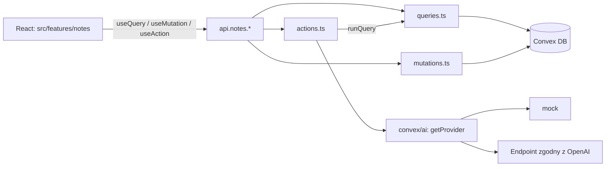

# Architektura

Ten dokument pokazuje, z czego składa się starter, którędy płyną dane i jak dodać własną funkcję tak, żeby nie wchodzić w drogę reszcie zespołu. Pełny projekt i źródła są w [specs/starter-architecture.md](../specs/starter-architecture.md).

## Elementy

| Element            | Gdzie                                                                     | Rola                                                                                                         |
| ------------------ | ------------------------------------------------------------------------- | ------------------------------------------------------------------------------------------------------------ |
| Frontend           | `src/`                                                                    | Vite + React 19 + Tailwind 4. Tylko widok i walidacja formularzy, bez logiki biznesowej.                     |
| Backend            | `convex/`                                                                 | Baza, zapytania, mutacje i akcje Convex. Tu mieszka logika biznesowa.                                        |
| Warstwa AI         | `convex/ai/`                                                              | Interfejs `AIProvider`, dostawca `mock` i adapter zgodny z OpenAI. Opis: [ai-providers.md](ai-providers.md). |
| Funkcje (features) | `src/features/<nazwa>/` i `convex/<nazwa>/`                               | Wszystko, co należy do jednej funkcji, w dwóch katalogach o tej samej nazwie.                                |
| Kod wspólny        | `src/app/`, `src/lib/`, `src/components/ui/`, `convex/lib/`, `convex/ai/` | Router, layout, env, prymitywy UI. Zmiany tylko w osobnym PR (patrz niżej).                                  |

Przykładowa funkcja to `notes`: lista notatek, formularz dodawania i przycisk „Streść” wywołujący AI.

## Przepływ danych



- Zapytania (`queries.ts`) czytają bazę, a React subskrybuje je reaktywnie: po zapisie notatki lista odświeża się sama.
- Mutacje (`mutations.ts`) zapisują dane i walidują wejście. Limit długości notatki (`convex/notes/limits.ts`) jest wspólny dla backendu i UI, dlatego plik nie importuje niczego serwerowego.
- Akcje (`actions.ts`) mogą wołać `fetch`, więc tylko one rozmawiają z modelem. Akcja `summarize` czyta notatki przez `ctx.runQuery(api.notes.queries.list)`, buduje prompt i prosi dostawcę o ustrukturyzowaną odpowiedź zwalidowaną schematem Zod. Frontend nigdy nie widzi klucza ani nie łączy się z modelem.
- Konfiguracja AI pochodzi ze zmiennych środowiska wdrożenia Convex (`npx convex env set ...`), nie z `.env.local`.

## Gdzie leży logika biznesowa

W `convex/`, nigdy w komponentach React. Czyste funkcje pomocnicze, których potrzebuje więcej niż jedna funkcja, trafiają do `convex/lib/`, ale dopiero gdy pojawi się drugi użytkownik (sugestia startera: najpierw kod we własnej funkcji, wspólny dopiero po uzgodnieniu z zespołem). Komponent woła `api.<nazwa>.<rola>.<funkcja>` i wyświetla wynik.

Zod pilnuje granic: zmienne środowiska (`src/lib/env.ts`, `convex/ai/config.ts`), odpowiedzi modelu i formularze.

## Katalog `convex/_generated/`

Jest generowany przez Convex i **commitowany**, żeby świeży klon przechodził `typecheck` bez wdrożenia. Zasady:

- Nie edytuj go ręcznie.
- Dodanie, zmiana nazwy lub usunięcie pliku w `convex/` wymaga regeneracji w tym samym commicie: `npx convex codegen`.
- `npm run codegen:check` uruchamia `npx convex codegen` i zawodzi, gdy wynik różni się od zacommitowanych plików. Skrypt wymaga skonfigurowanego wdrożenia Convex (wgrywa funkcje na deployment dev), więc działa lokalnie i w lane'ach, nie w CI. Jeśli nie masz wdrożenia: `npx convex dev --once` (patrz [README](../README.md)).
- Konflikt w `_generated` przy rebase: weź dowolną stronę i uruchom `npx convex codegen`.
- Zmiany w plikach pod `convex/` nie powinny iść równolegle w kilku gałęziach, bo każda regeneruje te same pliki.

## Nazwy wygenerowanego API

Nazwa pliku w `convex/` staje się częścią ścieżki API, więc pliki nazywamy rolami:

| Plik                        | Eksport     | Odwołanie                     |
| --------------------------- | ----------- | ----------------------------- |
| `convex/notes/queries.ts`   | `list`      | `api.notes.queries.list`      |
| `convex/notes/mutations.ts` | `add`       | `api.notes.mutations.add`     |
| `convex/notes/actions.ts`   | `summarize` | `api.notes.actions.summarize` |

Funkcje wewnętrzne (np. `seed.ts`, `internalMutation`) są dostępne jako `internal.notes.seed.*` i nie trafiają do `api`.

## Jak dodać funkcję, krok po kroku

Podział na dwa PR-y wynika z pliku wspólnego `convex/schema.ts`: kontrakt danych idzie pierwszy, dzięki czemu reszta zespołu może się na nim oprzeć.

**PR 1: kontrakt (`chore/<n>-contract-<slug>`, tytuł `feat(contract): ...`)**

1. Utwórz `convex/<nazwa>/tables.ts` z tabelami funkcji, wzorując się na `convex/notes/tables.ts` (eksportuje obiekt `notesTables` z `defineTable`).
2. Dodaj do `convex/schema.ts` jedną linię importu i jedno `...<nazwa>Tables`.
3. Zregeneruj `convex/_generated` (`npx convex codegen`) i dodaj test kontraktu, jeśli jest potrzebny.
4. Zmiany schematu są wyłącznie addytywne: nowe tabele i nowe pola opcjonalne. Zmiana nazwy lub usunięcie pola to osobna decyzja zespołu.

**PR 2: funkcja (`feat/<n>-<slug>`)**

1. Backend: `convex/<nazwa>/queries.ts`, `mutations.ts`, `actions.ts` (tylko te, których potrzebujesz) oraz testy `*.test.ts` obok kodu (`convex-test`). Zregeneruj `_generated`.
2. Frontend: `src/features/<nazwa>/` z plikiem `feature.tsx`. Jego domyślny eksport rejestruje się sam:

   ```tsx
   export default {
     path: "/notes",
     navLabel: "Notatki",
     order: 10,
     element: <NotesPage />,
   };
   ```

   `src/app/router.tsx` zbiera takie pliki przez `import.meta.glob("../features/*/feature.tsx")`, waliduje Zodem (`path` zaczyna się od `/`, `navLabel` niepusty, `order` liczba) i sam buduje trasy oraz menu. Nie edytujesz routera ani layoutu.

3. Testy komponentów (Vitest + Testing Library), a przy akcjach AI stub `fetch` zamiast prawdziwego modelu.
4. Przed PR: `npm run overlap` i `npm run verify`. W treści PR wpisz `Closes #<n>`.

Zależność npm to też zmiana pliku wspólnego (`package.json`, lockfile): idzie w osobnym PR po sprawdzeniu pakietu (licencja, utrzymanie, rozmiar).

## Pliki wspólne (hot files)

Lista jest w [.github/hot-files.txt](../.github/hot-files.txt) i to jedyne źródło prawdy dla skryptu `npm run overlap`, CI i `CLAUDE.md`:

- `convex/schema.ts`, `convex/*/tables.ts` (oraz testy kontraktu `convex/schema.test.ts`, `convex/*/tables.test.ts`),
- `convex/ai/**`, `convex/lib/**`,
- `src/app/**`, `src/components/ui/**`, `src/lib/**`,
- `package.json`, `package-lock.json`, `.github/**`, `.claude/**`, `CLAUDE.md`,
- skrypty `scripts/hot-files-check.mjs`, `scripts/lib/hot-files.mjs`,
- pliki konfiguracyjne w katalogu głównym (`*.config.*`, `tsconfig*.json`, `.env.example`, `.env.e2e`, `.gitattributes`, `.gitignore`, `.npmrc`, `.nvmrc`, `.prettierrc.json`, `.prettierignore`, `index.html`, `vercel.json`).

`convex/_generated/**` jest wyjęty spod reguły: to wygenerowany wynik, który jedzie razem ze zmianą, która go wywołała. Nie liczy się jako plik wspólny ani zwykły.

CI odrzuca PR mieszający pliki wspólne ze zwykłymi, chyba że w opisie jest zaznaczone pole `- [ ] Zmiana plików wspólnych uzgodniona z zespołem` (po zaznaczeniu użyj „Re-run failed jobs”). Typowa funkcja tego nie potrzebuje, jeśli trzymasz podział na dwa PR-y.

## Dlaczego `declare const process` w `convex/notes/actions.ts`

Frontendowy `tsconfig.app.json` typuje także ten plik, bo `convex/_generated/api.d.ts` importuje typy akcji. Gdyby dodać tam typy Node, w kodzie `src/` zniknęłyby błędy dotyczące API przeglądarki. Dlatego akcja deklaruje tylko to, czego używa (`process.env`), zamiast włączać `@types/node`.
