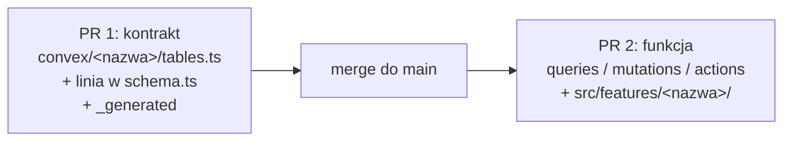

# Codzienny przepływ pracy

Jak pracować w 24 godziny w pięć osób, z kilkoma równoległymi ścieżkami (lanes) na osobę. Zasady
zespołu (gałęzie, commity, recenzje) są w [CONTRIBUTING.md](../CONTRIBUTING.md), a budowa kodu w
[architecture.md](architecture.md). Tu jest rytm pracy i narzędzia, które zapobiegają kolizjom.

## Tryb „light hackathon”

Bez ceremonii, ale z jedną kartką specyfikacji na funkcję:

1. Weź issue (opis w [github-issues-workflow.md](github-issues-workflow.md)) i przypisz je sobie.
2. Dla funkcji napisz jednostronicową specyfikację w `specs/<funkcja>.md`: zakres i kryteria
   akceptacji. Drobne poprawki jej nie potrzebują.
3. Zaimplementuj ją w `src/features/<nazwa>/` i `convex/<nazwa>/`.
4. Osobny recenzent (agent albo człowiek) sprawdza diff względem kryteriów akceptacji.
5. `npm run verify`, potem PR z `Closes #<nr>`.

Pierwszego dnia, przed pierwszą linijką kodu, przejdź przez [SETUP_PROMPT.md](../SETUP_PROMPT.md).

## Start środowiska

Wymagany jest Node 24 (`.nvmrc`) i npm. Yarn i pnpm nie są wspierane (`engine-strict`).

```bash
npm ci
npx playwright install chromium   # raz, dla testów e2e
npm run dev:frontend              # sam Vite; offline, dopóki .env.local nie ma VITE_CONVEX_URL
npm run dev                       # Convex + Vite, gdy Convex jest skonfigurowany
```

Backend Convex bez konta (lokalny, anonimowy):

```bash
CONVEX_AGENT_MODE=anonymous npx convex dev --once
```

W PowerShellu: `$env:CONVEX_AGENT_MODE='anonymous'; npx convex dev --once`. Pierwsze uruchomienie
`npx convex dev` z kontem zapisuje `VITE_CONVEX_URL` do `.env.local`. Brak tej zmiennej to tryb
offline: aplikacja działa, a na górze widać baner.

## Ścieżki (lanes)

Ścieżka to jeden git worktree z jednym właścicielem (osobą albo agentem), własnymi portami i własnym
deploymentem Convex. Dzięki temu dwie ścieżki nie nadpisują sobie danych ani nie walczą o port.

```bash
npm run lane:new -- <osoba> <nr-issue> <slug> [--local]
npm run lane:list
npm run lane:rm -- <nr-issue>-<slug> [--force]
```

Przykład: `npm run lane:new -- ania 12 login` robi:

- worktree `../<repo>-12-login` na gałęzi `feat/12-login`,
- `npm ci` w tym worktree (zajmuje minutę lub dwie), żeby `npx convex` używał przypiętej wersji,
- deployment Convex `dev/ania/12-login` typu dev, wygasający po 7 dniach, wybrany jako domyślny
  dla tego worktree (zapisany w jego `.env.local`),
- pierwszą wolną parę portów na tej maszynie: ścieżka 1 to `5174` (dev) i `4174` (preview),
  ścieżka 2 to `5175` i `4175` i tak dalej. Porty trafiają do `.env.local` jako `PORT` i
  `PREVIEW_PORT`. Główny checkout zostaje na `5173` i `4173`.

Szczegóły działania:

- Bez `--local` `lane:new` wymaga zalogowanego CLI: najpierw `npx convex login`, bo bez logowania
  utworzenie deploymentu się nie uda. Z `--local` powstaje deployment lokalny, który logowania nie
  potrzebuje (patrz niżej).
- Porty są liczone **na maszynę**: zderzają się tylko procesy na tym samym komputerze. Dwie osoby
  mogą obie mieć ścieżkę 1 na swoich laptopach. Vite ma `strictPort`, więc zajęty port kończy się
  jawnym błędem, a nie cichą zmianą portu.
- `lane:list` pokazuje worktree na gałęziach `feat/*` razem z portami i deploymentem.
- `lane:rm` usuwa worktree, ale **zostawia gałąź** (usuń ją `git branch -d`, gdy PR jest scalony)
  i **nie usuwa deploymentu Convex**. CLI Convex 1.50 nie ma komendy `deployment delete`: usuń
  deployment w panelu Convex (Project → Deployments) albo poczekaj, aż wygaśnie po 7 dniach.
  Niezacommitowane zmiany blokują usunięcie, wymusza je `--force`.
- Raporty testów (`reports/`, `coverage/`) lądują w katalogu worktree, więc ścieżki ich nie
  nadpisują.

### Limit deploymentów i deployment lokalny

Plan darmowy Convex dopuszcza do 6 developerów i 40 deploymentów na zespół
([cennik](https://www.convex.dev/pricing), [limity](https://docs.convex.dev/production/state/limits)).
Każda ścieżka z deploymentem w chmurze to jeden z nich. Szacunkowo: pięć osób, produkcja i
około 25 ścieżek to ok. 31 deploymentów. Mieści się to w 40 tylko wtedy, gdy skończone ścieżki
znikają albo wygasają. Stąd domyślne 7 dni.
Opis wielu deploymentów: [Convex, multiple deployments](https://docs.convex.dev/production/multiple-deployments).

Gdy zespół zbliża się do limitu, używaj deploymentu **lokalnego**:

```bash
npm run lane:new -- ania 12 login --local
```

Deployment lokalny (beta) nie zużywa limitu, działa na Twojej maszynie i nie wymaga logowania
([dokumentacja](https://docs.convex.dev/cli/local-deployments)). Jego dane leżą w worktree, w
`<ścieżka>/.convex/local/default`, więc znikają razem z nim. Nie widać ich z innej maszyny.

## Unikanie kolizji

Bez zabezpieczeń pięć osób z kilkoma ścieżkami będzie zmieniać te same pliki.

### 1. Funkcje dodają pliki

Nowa strona to nowy katalog `src/features/<nazwa>/` z `feature.tsx`, który sam rejestruje trasę.
Nowy backend to `convex/<nazwa>/`. Nie edytujesz routera ani layoutu. Zmiany schematu są
**addytywne**: nowe tabele i nowe pola opcjonalne. Zmiana nazwy albo usunięcie pola to zmiana
kontraktowa.

### 2. Sprawdź, kto rusza te same pliki

```bash
npm run overlap                          # moje zmiany kontra otwarte PR-y i inne worktree
npm run overlap -- --paths "src/features/login/**" "convex/login/**"   # plan, zanim zacznę
npm run overlap -- --strict              # kod wyjścia 1 przy nakładaniu się plików wspólnych
```

Skrypt porównuje zmienione pliki z każdym otwartym PR-em (`gh pr list`) i z diffem pozostałych
worktree względem `origin/main`, a pliki wspólne oznacza. Uruchom go **przed startem** i **przed
otwarciem PR**. Przy nakładaniu się plików wspólnych zatrzymaj się i zapytaj człowieka. Wymaga
zalogowanego `gh` (`gh auth login`). W polu „Planowany zakres plików” w issue podajesz te same
ścieżki, które potem trafiają do `--paths`.

### 3. Pliki wspólne: najpierw kontrakt

Lista plików wspólnych (hot files) leży w [`.github/hot-files.txt`](../.github/hot-files.txt).
Należą do niej m.in. `convex/schema.ts`, `convex/*/tables.ts`, `convex/ai/**`, `convex/lib/**`,
`src/app/**`, `src/lib/**`, `src/components/ui/**`, `package.json`, `package-lock.json`,
`.github/**`, `.claude/**`, `CLAUDE.md` i pliki konfiguracyjne w korzeniu. Wygenerowane `convex/_generated/**`
jest wyłączone z podziału: dołącza do zmiany, która je wywołała.

Zmiana pliku wspólnego idzie we **własnym, małym PR-ze** (gałąź `chore/<nr>-contract-<slug>`,
tytuł `feat(contract): …`), scalonym przed pracą, która jej potrzebuje. Pozostali robią rebase.
Typowa funkcja backendowa to dwa PR-y:



Nowa zależność npm to też zmiana pliku wspólnego (`package.json` i lockfile). Najpierw sprawdź
pakiet (czy istnieje pod oczekiwaną nazwą, licencja, utrzymanie, znane podatności), potem uzgodnij z
zespołem i dodaj go w PR-ze kontraktowym. Nie instaluj pakietów w gałęzi funkcji.

CI (job `hot-files`) odrzuci PR, który miesza pliki wspólne z innymi. Wyjście awaryjne dla
naprawdę drobnych przypadków:

1. W opisie PR zaznacz pole `- [ ] Zmiana plików wspólnych uzgodniona z zespołem` i napisz, dlaczego
   to idzie razem.
2. W zakładce Checks naciśnij **Re-run failed jobs**.

Edycja opisu PR nie uruchamia CI sama z siebie, a ponowne uruchomienie używa starego zdarzenia.
Dlatego job czyta **aktualną** treść PR (`gh pr view`), a nie dane ze zdarzenia. Samo zaznaczenie
pola nie wystarczy: bez „Re-run failed jobs” check zostaje czerwony.

### 4. Integracja: kolejka scalania i krótkie gałęzie

- Jeśli repo jest w organizacji i kolejka scalania jest włączona, `main` ma **kolejkę**: każdy PR jest testowany jeszcze raz na szczycie aktualnego `main`
  razem z PR-ami przed nim, więc dwa osobno zielone PR-y, które się gryzą, nie wejdą oba
  ([dokumentacja GitHub](https://docs.github.com/en/repositories/configuring-branches-and-merges-in-your-repository/configuring-pull-request-merges/managing-a-merge-queue)).
  Wymaga repozytorium w organizacji, patrz [CONTRIBUTING.md](../CONTRIBUTING.md).
- Scalamy wyłącznie **squash**: jeden commit na PR, łatwy revert.
- Gałęzie żyją krótko, najlepiej do ok. 4 godzin pracy. `git fetch && git rebase origin/main` co
  kilka godzin i przed otwarciem PR.

## Konflikty w plikach generowanych

Repozytorium ma `.gitattributes` z `* text=auto eol=lf`, więc Windows nie produkuje konfliktów
całych plików przez końce linii. `package-lock.json` i `convex/_generated/**` są oznaczone jako
generowane (zwinięte w diffach PR). Prettier w `verify` usuwa konflikty samego formatowania.

**Konflikt w `package-lock.json`:**

```bash
git checkout origin/main -- package-lock.json   # weź wersję z main
npm install                                     # dopisuje Twoje zmiany do świeżego lockfile
git add package-lock.json && git rebase --continue
```

Nazwy `--ours` i `--theirs` są w trakcie `git rebase` odwrócone, więc wskazanie `origin/main`
wprost jest bezpieczniejsze.

**Konflikt w `convex/_generated/**`:** weź dowolną stronę i wygeneruj pliki od nowa:

```bash
git checkout origin/main -- convex/_generated
npx convex codegen
git add convex/_generated
```

**`npm run codegen:check`** uruchamia `convex codegen` i kończy się błędem, gdy `convex/_generated`
różni się od zacommitowanego. Wymaga skonfigurowanego deploymentu (wystarczy
`npx convex dev --once`), więc to kontrola lokalna i w ścieżkach, a nie w CI. Po dodaniu albo
usunięciu pliku w `convex/` zawsze regeneruj kod i commituj go razem ze zmianą. Zmiany w `convex/`
nie idą równolegle z innymi zmianami plików w `convex/`.

## Hooki i kontrola przed PR

Repo zawiera hook dla Claude Code (`.claude/settings.json`): po każdej edycji pliku uruchamia
`tsc -b`, żeby błędy typów wychodziły od razu. To wygoda, nie zastępuje `npm run verify`.

Przed każdym PR:

```bash
git fetch && git rebase origin/main
npm run overlap
npm run verify
```

`verify` to dokładnie to, co robi job CI: `format:check`, `lint`, `typecheck`, `test:coverage`,
`build`, `test:e2e`. Pełny opis testów: [testing.md](testing.md).
