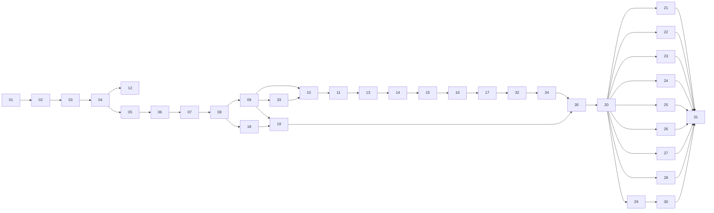

# Implementation plan

Source of truth for design: `specs/starter-architecture.md` (referred to as **ARCH section n**).
Status: implemented | Date: 2026-11-17

## Conventions for every task

- One task is roughly one commit, Conventional Commits (`feat:`, `chore:`, `test:`, `ci:`, `docs:`).
- Touch only the files listed. A needed file outside the list, or a dependency not named in
  ARCH 4.2, is a scope change: stop and report it instead of adding it.
- Install with exact versions from ARCH 4.2 (`.npmrc` has `save-exact=true`). `package.json` and
  `package-lock.json` are listed wherever a task installs something or edits scripts.
- Every non-trivial change ships with tests. Before reporting done, run every check that exists at
  that point (`format:check`, `lint`, `typecheck`, `test`, and from task 07 on `npm run verify`).
- Minimal comments: only non-obvious _why_, workarounds, gotchas.
- Any markdown file must pass `prettier --check`.
- Any task that adds, renames or removes a file under `convex/` regenerates `convex/_generated/`
  with the command ARCH 5.1 prescribes (settled in task 04) in the same commit. Those tasks never run in parallel.
- Workflow tasks: validate with `actionlint` (release binary downloaded to a temp dir, checksum
  verified; not added to the repo).

Legend: **Model** = suggested coder model. **Creds** = needs something only the repo owner can supply.

## Order and parallelism

Walking skeleton first (brief Phase 2): the app is deployed (task 09) before any feature layer
(task 10 onward).

Groups that may run in parallel (file lists do not overlap):

- **P1:** 12 || any task from 05 to 17 (it touches only `.env.example`).
- **P2:** 18 || any task from 10 to 17 (CI file vs. app files). 19 waits for 09 and 18.
- **P3:** 21 || 22 || 23 || 24 || 25 || 26 || 27 || 28 || 29 (each owns its own files).

Strictly sequential: everything touching `convex/` (04, 11, 13, 14, 15, 16) because of
`convex/_generated`, and everything touching `package.json`/`package-lock.json`
(01, 02, 03, 04, 06, 07, 33, 11, 32, 34, 30). Tasks 32-35 are numbered last because they were
added in review round 2 (lanes, collision guards); the graph shows where they run.

---

## Phase 2 - Walking skeleton (deployed first)

### 01-scaffold-frontend

**Goal:** Vite + React + strict TS + Tailwind app with a minimal homepage; Node/npm pinned; MIT license.
**Deps:** none | **Model:** sonnet

Files: `package.json`, `package-lock.json`, `.nvmrc`, `.npmrc`, `.gitignore`, `.gitattributes`, `LICENSE`,
`index.html`, `vite.config.ts`, `tsconfig.json`, `tsconfig.app.json`, `tsconfig.node.json`,
`src/main.tsx`, `src/App.tsx`, `src/index.css`, `src/vite-env.d.ts`, `public/favicon.svg`

- [ ] `.nvmrc` = `24`; `engines` = `{ "node": ">=24.15.0 <25", "npm": ">=10" }`; `.npmrc` has `save-exact=true` and `engine-strict=true` (ARCH 4.1).
- [ ] Deps at ARCH 4.2 versions: react, react-dom, react-router, zod, vite, @vitejs/plugin-react, typescript 6.0.3, tailwindcss, @tailwindcss/vite, @types/react, @types/react-dom, @types/node.
- [ ] tsconfigs follow ARCH 4.3: `types` set explicitly in each (`["vite/client"]` app, `["node"]` node), `strict: true`, `moduleResolution: "bundler"`, `noUncheckedIndexedAccess`, `noUnusedLocals`, `noUnusedParameters`, no `baseUrl`, no `ignoreDeprecations`; `tsc -b` passes with zero deprecation warnings.
- [ ] `vite.config.ts` reads `PORT` (default 5173) and `PREVIEW_PORT` (default 4173), both `strictPort: true`.
- [ ] Scripts: `dev:frontend`, `build` (`tsc -b && vite build`), `preview`, `typecheck` (`tsc -b`).
- [ ] Homepage renders a heading styled with Tailwind; `npm run build` succeeds.
- [ ] `.gitignore` covers `node_modules`, `dist`, `dist-e2e`, `.env`, `.env*.local`, `coverage`, `reports`, `playwright-report`, `test-results`, `.convex`, `.vercel`, `*.tsbuildinfo`.
- [ ] `LICENSE` is the MIT text with year 2026 and holder "HackNation starter contributors".
- [ ] `.gitattributes` per ARCH 14.5: `* text=auto eol=lf`; `package-lock.json` and `convex/_generated/**` marked `linguist-generated=true`. Existing files renormalised.

### 02-lint-format

**Goal:** ESLint flat config + Prettier, project formatted.
**Deps:** 01 | **Model:** sonnet

Files: `package.json`, `package-lock.json`, `eslint.config.js`, `.prettierrc.json`, `.prettierignore`, any file reformatted by Prettier

- [ ] Deps: eslint, @eslint/js, typescript-eslint, eslint-plugin-react-hooks, eslint-plugin-react-refresh, eslint-config-prettier, globals, prettier, prettier-plugin-tailwindcss.
- [ ] typescript-eslint type-aware recommended config; `@typescript-eslint/no-explicit-any` = error.
- [ ] Ignores: `dist`, `dist-e2e`, `coverage`, `reports`, `convex/_generated`, `playwright-report`, `test-results`.
- [ ] Scripts `lint`, `format`, `format:check`; all pass on the repo.
- [ ] `.prettierignore` excludes `package-lock.json`, `convex/_generated`, build/report dirs.

### 03-vitest-harness

**Goal:** Vitest with the `frontend` (jsdom) project, JSON reporter, v8 coverage, first component test.
**Deps:** 02 | **Model:** sonnet

Files: `package.json`, `package-lock.json`, `vitest.config.ts`, `src/test/setup.ts`, `src/App.test.tsx`, `tsconfig.app.json`, `tsconfig.node.json`

- [ ] Deps: vitest, @vitest/coverage-v8, @testing-library/react, @testing-library/dom, @testing-library/jest-dom, @testing-library/user-event, jsdom. (`convex-test` and `@edge-runtime/vm` come in task 04, with `convex`.)
- [ ] `vitest.config.ts` uses `projects` with a `frontend` project (jsdom, `src/**/*.test.{ts,tsx}`), ready for a second project.
- [ ] Reporters `default` + `json` -> `reports/vitest.json`; coverage v8 -> `coverage/` with `text-summary`, `lcov`, `json-summary`; no threshold.
- [ ] Scripts `test`, `test:watch`, `test:coverage`; `src/App.test.tsx` renders the homepage heading and passes.
- [ ] Test files are typechecked by `npm run typecheck`; jest-dom/vitest types are listed explicitly in `types` (ARCH 4.3).

### 04-convex-notes-backend

**Goal:** Convex configured with a `notes` table, `api.notes.queries.list` query and `api.notes.mutations.add` mutation, tested with `convex-test`; `npm run dev` works.
**Deps:** 03 | **Model:** sonnet | **Creds:** repo owner runs `npx convex dev --once` once to log in and create the dev deployment (or the coder uses `--configure new --dev-deployment local` if it works without login).

Files: `package.json`, `package-lock.json`, `convex/schema.ts`, `convex/notes/tables.ts`, `convex/notes/queries.ts`, `convex/notes/mutations.ts`, `convex/notes/notes.test.ts`, `convex/tsconfig.json`, `convex/_generated/*`, `tsconfig.json`, `vitest.config.ts`

- [ ] Feature-folder layout per ARCH 5 and 14.1: `convex/notes/tables.ts` exports the notes tables; `convex/schema.ts` only spreads feature tables (one import line per feature).

- [ ] Deps: `convex@1.50.0`, `convex-test@0.0.71`, `@edge-runtime/vm@5.0.0` (installed together so npm never auto-installs an unpinned `convex` peer).
- [ ] `vitest.config.ts` gains the `backend` project (`edge-runtime`, `convex/**/*.test.ts`) (ARCH 8.2).
- [ ] Script `dev` = `convex dev --start "vite"` (ARCH 9).
- [ ] `convex/_generated` committed and excluded from lint/format (ARCH 5.1).
- [ ] Schema: `notes { text: string, createdAt: number }`, index `by_createdAt`.
- [ ] `list` returns newest first, max 50; `add` validates args with Convex `v`, trims text, enforces 1-500 chars, throws `ConvexError` on invalid input.
- [ ] `convex-test` tests: add then list; ordering; empty text rejected; 501-char text rejected.
- [ ] Codegen without a deployment verified on a clean clone with no `.env.local`: `npx convex codegen --typecheck disable`. Result and the resulting prescribed command recorded in the report, and ARCH 5.1 updated by the CTO accordingly.
- [ ] Module names follow ARCH 5.1: `api.notes.queries.list`, `api.notes.mutations.add`.
- [ ] `npx convex dev --once` succeeds with `convex/notes/notes.test.ts` present; the report states whether the CLI skips or bundles `*.test.ts` (ARCH 5.1) and what was done if it bundles them.
- [ ] `convex/tsconfig.json` compiles under TS 6.0 with no deprecation warnings; any edit to the generated file is listed in the report (ARCH 4.3).
- [ ] If `convex-test` fails on Vitest 5, pin vitest + coverage-v8 to 4.1.12 and note it in the report (ARCH A3).

### 05-app-shell-env

**Goal:** Zod-validated frontend env, Convex provider or offline mode, router with layout, home page showing backend status.
**Deps:** 04 | **Model:** sonnet

Files: `src/main.tsx`, `src/App.tsx`, `src/App.test.tsx`, `src/app/router.tsx`, `src/app/Layout.tsx`, `src/app/Providers.tsx`, `src/app/OfflineBanner.tsx`, `src/app/*.test.tsx`, `src/routes/HomePage.tsx`, `src/routes/NotFoundPage.tsx`, `src/lib/env.ts`, `src/lib/env.test.ts`, `src/components/ui/*`

- [ ] `src/lib/env.ts` parses `import.meta.env` with Zod; `VITE_CONVEX_URL` optional URL, **empty string treated as unset** (ARCH 8.4); invalid value -> clear error message.
- [ ] Without `VITE_CONVEX_URL` the app renders with `OfflineBanner` (Polish text) and no Convex client; with it, `ConvexProvider` wraps the app (ARCH 7).
- [ ] Home page, when online, shows a small backend status using `api.notes.queries.list` (e.g. "Backend polaczony - N notatek"), so the deployed skeleton proves the frontend-to-Convex path.
- [ ] Routes: `/` (home), `*` (not found). `router.tsx` and `Layout` build feature routes and nav entries from `import.meta.glob("../features/*/feature.tsx", { eager: true })` (ARCH 14.1); `feature.tsx` contract (`path`, `navLabel`, `order`, `element`) typed and validated. Test: a fixture feature module appears in routes and nav without editing the router.
- [ ] Minimal UI primitives (`Button`, `Card`, `Input`) with accessible focus styles.
- [ ] Tests use `vi.stubEnv` for online/offline, never the developer's real env: env parsing (valid/missing/empty/invalid), offline banner, online status with mocked `useQuery`, not-found route.

### 06-playwright-smoke

**Goal:** Fast Chromium smoke test against an `e2e`-mode build that is offline everywhere.
**Deps:** 05 | **Model:** sonnet

Files: `package.json`, `package-lock.json`, `playwright.config.ts`, `.env.e2e`, `e2e/smoke.spec.ts`, `tsconfig.node.json`, `eslint.config.js`, `.prettierignore`

- [ ] Dep `@playwright/test@1.65.1`; script `test:e2e`.
- [ ] `.env.e2e` (committed) contains `VITE_CONVEX_URL=` and a comment explaining why (ARCH 8.4).
- [ ] `webServer` builds with `vite build --mode e2e --outDir dist-e2e` and serves with `vite preview --mode e2e --outDir dist-e2e --port <PREVIEW_PORT> --strictPort`; `reuseExistingServer` off in CI.
- [ ] If `VITE_CONVEX_URL` is set in the shell environment, `test:e2e` fails fast with a clear message.
- [ ] Reporters: `list` + `json` -> `reports/playwright.json`; `html` (open: never) only outside CI.
- [ ] Smoke covers: load, heading, offline banner visible, unknown route shows not-found and nav back home works.
- [ ] **`npm run test:e2e` passes with a `.env.local` containing a real-looking `VITE_CONVEX_URL`** (create it temporarily, delete after; show output in the report).
- [ ] Suite runs in < 30 s locally excluding the build.

### 07-verify-script

**Goal:** `npm run verify` = the CI quality job.
**Deps:** 06 | **Model:** haiku

Files: `package.json`, `package-lock.json`

- [ ] Dep `npm-run-all2@9.0.4`.
- [ ] `verify` = `run-s format:check lint typecheck test:coverage build test:e2e` (ARCH 8.6).
- [ ] Passes on Windows (PowerShell) and in a POSIX shell, with and without a `.env.local` containing `VITE_CONVEX_URL`.

### 08-ci-verify

**Goal:** Minimal PR workflow green: verify job + gate job.
**Deps:** 07 | **Model:** sonnet | **Creds:** a GitHub remote is needed to observe a real run.

Files: `.github/workflows/ci.yml`

- [ ] Triggers `pull_request` (main), `merge_group`, `workflow_call`; top-level `permissions: contents: read`.
- [ ] Job-level concurrency per ARCH 10.1: group `ci-${{ github.event_name }}-${{ github.ref }}-<job>`, `cancel-in-progress: ${{ github.event_name == 'pull_request' }}`; no workflow-level concurrency.
- [ ] `verify` job: checkout, setup-node from `.nvmrc` with npm cache, `npm ci`, `npx playwright install --with-deps chromium`, `npm run verify`, upload `reports/` + `coverage/` (`if: always()`).
- [ ] `gate` job `needs: [verify]`, `if: always()`, fails unless all needs succeeded.
- [ ] All actions pinned by full SHA with a version comment; `actionlint` clean.
- [ ] Once a remote exists: a PR run is green (otherwise marked "not verified" in the report).

### 09-deploy-pipeline

**Goal:** Main-branch deploy of Convex + Vercel through GitHub Actions; skips cleanly without secrets.
**Deps:** 08 | **Model:** sonnet | **Creds:** Vercel project (`VERCEL_TOKEN`, `VERCEL_ORG_ID`, `VERCEL_PROJECT_ID`), Convex production deploy key (`CONVEX_DEPLOY_KEY`), GitHub remote with a `production` environment.

Files: `.github/workflows/deploy.yml`, `vercel.json`

- [ ] Shape per ARCH 10.2; `verify` reused via `uses: ./.github/workflows/ci.yml`; workflow concurrency group `deploy-production`, no cancel, no clash with ci.yml's job groups.
- [ ] Missing secret -> job summary notice, job succeeds, nothing deployed.
- [ ] After the build step, `.vercel/output/static` is searched for the production Convex URL host; missing -> job fails (ARCH 10.2 step 4).
- [ ] `vercel.json` disables Git deployments and has an SPA rewrite to `/index.html` so deep links work.
- [ ] `actionlint` clean.
- [ ] With creds: a push to main deploys; the production URL shows the home page **online** (no offline banner, backend status visible). Otherwise reported as "requires credentials".

### 10-notes-ui

**Goal:** Notes feature: list and add, Zod form validation, offline-safe; smoke test extended.
**Deps:** 33 | **Model:** sonnet

Files: `src/features/notes/*` (`feature.tsx`, `NotesPage.tsx`, components, `schema.ts`, hooks, tests), `e2e/smoke.spec.ts`

- [ ] The feature registers itself through `src/features/notes/feature.tsx`; **no file under `src/app/` changes** (proves ARCH 13 AC13 on the frontend).

- [ ] Form schema in `src/features/notes/schema.ts` (Zod, 1-500 chars) mirrors the backend limit; type inferred from schema.
- [ ] Route `/notes` with a nav link; empty submit shows a Polish validation message; valid submit calls `api.notes.mutations.add`.
- [ ] In offline mode the page renders, the form validates, submit is disabled with an explanation.
- [ ] RTL tests (`vi.stubEnv` + mocked Convex hooks): validation error, offline state, list rendering.
- [ ] Smoke extended: home -> notes -> home navigation, empty-submit validation error.

## Phase 3 - Backend

### 11-seed-data

**Goal:** Idempotent seed for demos.
**Deps:** 10 | **Model:** sonnet

Files: `convex/notes/seed.ts`, `convex/notes/seed.test.ts`, `convex/_generated/*`, `package.json` (script `seed` only)

- [ ] `internalMutation` inserting ~5 Polish demo notes only when the table is empty.
- [ ] `npm run seed` = `convex run notes/seed:run`.
- [ ] Test: running twice yields the same count.
- [ ] `_generated` regenerated in the same commit.

### 12-env-example

**Goal:** `.env.example` documents every variable in ARCH 7.
**Deps:** 04 | **Model:** haiku

Files: `.env.example`

- [ ] Every variable from ARCH 7 with a one-line comment, where it is set (local / Convex env / GitHub secret), and a safe placeholder (no real-looking keys, no IPs).
- [ ] States that `AI_*` go into Convex with `npx convex env set`, not into `.env.local`, and that `VITE_CONVEX_URL` is never set in the Vercel project env.

## Phase 4 - AI infrastructure

### 13-ai-contract

**Goal:** Provider interface, error type and Zod config parsing.
**Deps:** 11 | **Model:** sonnet

Files: `convex/ai/types.ts`, `convex/ai/config.ts`, `convex/ai/config.test.ts`, `convex/_generated/*`

- [ ] Types per ARCH 6.2; `AIProviderError` with `code` and `retryable`.
- [ ] `parseAIConfig(env)` (Zod, discriminated on `AI_PROVIDER`, default `mock`): `openai-compatible` requires `AI_BASE_URL` (https URL, or http only for `localhost`/`127.0.0.1`), `AI_MODEL`, `AI_API_KEY`; defaults for timeout (20000), retries (1), structured mode (`json_schema`).
- [ ] Error messages never include the API key.
- [ ] Tests: defaults, each missing field, bad URL, http allowed only for loopback, key not in error text.
- [ ] The Convex CLI (`npx convex dev --once` against the dev deployment) accepts the new `convex/ai/*.ts` files (no Node-only imports, no `vitest` import outside `*.test.ts`) and `_generated` is regenerated in the same commit (ARCH 5.1).

### 14-ai-mock-provider

**Goal:** Deterministic mock provider.
**Deps:** 13 | **Model:** sonnet

Files: `convex/ai/mock.ts`, `convex/ai/mock.test.ts`, `convex/_generated/*`

- [ ] Scenarios per ARCH 6.3 (`[mock:error]`, `[mock:timeout]`, default canned Polish text).
- [ ] Structured output from per-`schemaName` fixtures, validated by the provided schema; unknown name -> `config` error.
- [ ] No timers, randomness or network; same input -> same output (tested).
- [ ] `_generated` regenerated in the same commit.

### 15-ai-openai-compatible

**Goal:** Path 3 adapter with timeouts, retries, normalization and structured modes.
**Deps:** 14 | **Model:** sonnet (bump to opus on a second bounce)

Files: `convex/ai/openaiCompatible.ts`, `convex/ai/openaiCompatible.test.ts`, `convex/_generated/*`

- [ ] Behaviour per ARCH 6.3 and 6.4; uses global `fetch` and `AbortSignal.timeout`.
- [ ] Error mapping: timeout -> `timeout`; network/5xx -> `unavailable` (retryable); 429 -> `rate_limited`; 401/403 -> `auth` (no retry); bad shape/invalid JSON/schema mismatch -> `bad_response`.
- [ ] Retries <= `maxRetries` with exponential backoff; backoff is injectable so tests do not sleep.
- [ ] `usage` mapped when present; `getProviderInfo` exposes only the base URL host, never the key.
- [ ] Tests with `vi.stubGlobal("fetch")`: success, usage, timeout, retry-then-success, retries exhausted, 401 no retry, malformed body, each structured mode's request body, schema mismatch.
- [ ] `_generated` regenerated in the same commit.

### 16-ai-summarize-action

**Goal:** Provider selection and the `api.notes.actions.summarize` action.
**Deps:** 15 | **Model:** sonnet

Files: `convex/ai/index.ts`, `convex/ai/index.test.ts`, `convex/notes/actions.ts`, `convex/notes/actions.test.ts`, `convex/_generated/*`

- [ ] `getProvider(config)` returns mock or openai-compatible; no automatic fallback between real providers.
- [ ] `summarize` in `convex/notes/actions.ts` (default runtime) reads notes via `ctx.runQuery(api.notes.queries.list)`, calls `generateStructuredOutput` with a Zod schema `{ summary: string, keyPoints: string[] }`, returns `{ ok: true, data, provider }` or `{ ok: false, code, message }` (Polish, user-safe).
- [ ] convex-test: mock path; `[mock:error]` path; openai-compatible path with stubbed `fetch`; missing config -> `config` error, not a crash.
- [ ] If the default runtime rejects something, report it (ARCH A4) before moving to `"use node"`.

### 17-summarize-ui

**Goal:** "Podsumuj notatki" button with result and graceful error display.
**Deps:** 16 | **Model:** sonnet

Files: `src/features/notes/*`

- [ ] Button calls `api.notes.actions.summarize` via `useAction`; loading state; disabled offline.
- [ ] Renders summary + key points; on `ok: false` shows the message and the rest of the page keeps working.
- [ ] RTL tests for success, error and offline states.

## Phase 5 - Testing

Covered inside tasks 03, 04, 06, 07 (harness, reporters, coverage, e2e mode, lane ports). Lane
isolation is documented in task 28. No separate task.

### 32-lane-script

**Goal:** One-command lanes for a ~5-person team running several worktrees each (ARCH 8.5, A6).
**Deps:** 17 | **Model:** sonnet | **Creds:** a logged-in Convex CLI (same setup as task 04)

Files: `scripts/lane.mjs`, `scripts/lane.test.ts`, `package.json` (scripts `lane:new`, `lane:list`, `lane:rm` only), `vite.config.ts`, `playwright.config.ts`, `.gitignore`, `vitest.config.ts`, `tsconfig.node.json`

- [ ] Vitest gains a `scripts` project (node environment, `scripts/**/*.test.ts`); `tsconfig.node.json` includes `scripts/**` with `allowJs` + `checkJs`, scripts carry JSDoc types, and `npm run typecheck` covers them with no implicit `any` (ARCH 9). Later script tasks (33, 34, 35) reuse this.

- [ ] `lane:new -- <member> <issue> <slug> [--local]` creates worktree `../<repo>-<issue>-<slug>` on `feat/<issue>-<slug>`, runs `npm ci` in it first (prints the expected wait), picks the first lane number whose ports are free on this machine, runs the worktree's own pinned `convex` (`npx convex` resolving from its `node_modules`) `deployment create dev/<member>/<issue>-<slug> --type dev --select --expiration "in 7 days"` (or the `local` reference with `--local`), and writes `PORT`/`PREVIEW_PORT` (ARCH 8.5).
- [ ] `lane:list` prints slug, path, ports, Convex deployment; `lane:rm -- <slug>` removes the worktree and only prints the deployment-deletion command.
- [ ] `vite.config.ts` and `playwright.config.ts` read ports from the worktree's env file (`loadEnv` / `process.loadEnvFile`).
- [ ] Verified: after `npx convex dev --once` in a lane, `PORT`/`PREVIEW_PORT` are still in `.env.local`; if not, ports move to a gitignored `.env.lane` (ARCH 8.5) and the report says so.
- [ ] Works on Windows (PowerShell) and POSIX; no Bash; uses only Node built-ins and the `git`/`npx convex` CLIs.
- [ ] Unit tests for argument parsing, slug validation (Convex reference: 3-100 chars, alphanumerics/dashes/slashes [S31]) and free-port selection (port probing injected).
- [ ] Two lanes created on one machine run `npm run dev` and `npm run test:e2e` at the same time without a port or data clash (shown in the report).

### 33-codegen-check

**Goal:** Detect stale `convex/_generated` so generated-file conflicts are resolved by regenerating (ARCH 14.5).
**Deps:** 09 | **Model:** sonnet

Files: `package.json` (scripts `codegen:check` and, if it qualifies, `verify`), `scripts/codegen-check.mjs`

- [ ] `codegen:check` runs `npx convex codegen` and fails with a clear message if `convex/_generated` differs from the committed version (cross-platform, no Bash).
- [ ] Verified whether `convex codegen` works with no configured deployment and no network credentials (clean clone, no `.env.local`). If yes: added to `verify` (and therefore CI). If no: kept out of `verify`, documented as a local/lane check, and the report says why.
- [ ] Shown: after a deliberately stale edit in a temp copy, the check fails; after regenerating, it passes.

### 34-overlap-script

**Goal:** `npm run overlap` shows who else touches my files (ARCH 14.2).
**Deps:** 32 | **Model:** sonnet

Files: `scripts/overlap.mjs`, `scripts/lib/hot-files.mjs`, `scripts/overlap.test.ts`, `.github/hot-files.txt`, `package.json` (script `overlap` only)

- [ ] `.github/hot-files.txt` contains the list from ARCH 14.2, including `convex/*/tables.ts`.
- [ ] `scripts/lib/hot-files.mjs` classifies `convex/_generated/**` as exempt (neither hot nor non-hot, ARCH 14.2).
- [ ] `scripts/lib/hot-files.mjs` loads the list and matches paths; uses Node's built-in `path.matchesGlob` if it is stable in Node 24, otherwise stop and report (a matcher library is a scope change).
- [ ] Compares my changed files (branch vs `origin/main` + working tree, or `--paths <globs>`) with open PRs (`gh pr list --state open --json number,title,author,headRefName,files`) and other local worktrees; output grouped by file, hot files marked; exit 0, or 1 with `--strict` on a hot-file overlap.
- [ ] Works offline or without `gh auth`: skips the PR part with a warning instead of failing.
- [ ] Unit tests with injected git/gh outputs: no overlap, PR overlap, lane overlap, hot-file marking, `--strict`, missing `gh`.

### 35-hot-files-ci

**Goal:** CI enforces the contract-first rule (ARCH 14.3).
**Deps:** 34, 19 | **Model:** sonnet

Files: `.github/workflows/ci.yml`, `scripts/hot-files-check.mjs`, `scripts/hot-files-check.test.ts`

- [ ] `hot-files` job (pull_request only) gets changed files from git (base...head), reads the **live** PR body with `gh pr view <n> --json body` (job `permissions: pull-requests: read`, `GH_TOKEN: ${{ github.token }}`), reuses `scripts/lib/hot-files.mjs`; fails only when hot and non-hot files are mixed and the acknowledgement checkbox is not ticked.
- [ ] `gate` needs `[verify, secrets, hot-files]`; passes only if `verify` and `secrets` are `success` and `hot-files` is `success`, or `skipped` only when `github.event_name != 'pull_request'` (ARCH 10.1). No `edited` trigger is added.
- [ ] Shown on a real PR (or documented as needing the remote): mixed PR fails, ticking the box + **Re-run failed jobs** turns `hot-files` and `gate` green.
- [ ] Unit tests: only hot files, only feature files, mixed without ack, mixed with ack, contract PR (`tables.ts` + `schema.ts` + `convex/_generated/**` + a contract test) passes without ack.
- [ ] Job-level concurrency like the other ci.yml jobs; `actionlint` clean.

## Phase 6 - CI/CD hardening

### 18-ci-gitleaks

**Goal:** Secret scanning job in the PR workflow.
**Deps:** 08 | **Model:** sonnet

Files: `.github/workflows/ci.yml`, `.gitleaks.toml` (only if an allowlist is needed)

- [ ] `secrets` job per ARCH 10.1: full-history checkout, gitleaks v8.30.1 linux_x64 downloaded and checksum-verified, `gitleaks git --redact`; job-level concurrency like the other ci.yml jobs.
- [ ] `gate` needs `[verify, secrets]`.
- [ ] Detection verified **locally only**: the same gitleaks version and flags find a planted fake key in a throwaway local git repo (or a `gitleaks dir` scan of a temp folder); output attached to the report. Nothing with a planted key is ever committed to this repo or pushed.
- [ ] `actionlint` clean.

### 19-ci-hardening

**Goal:** Speed and robustness pass on both workflows.
**Deps:** 09, 18 | **Model:** sonnet

Files: `.github/workflows/ci.yml`, `.github/workflows/deploy.yml`

- [ ] Playwright browsers cached by Playwright version; `timeout-minutes` on every job.
- [ ] Coverage summary written to the job summary.
- [ ] No duplicated jobs between PR and main (main reuses `ci.yml`); concurrency groups still distinct.
- [ ] Least-privilege `permissions` per job; `actionlint` clean.

## Phase 7 - AI-assisted development and docs

### 20-claude-md

**Goal:** Project `CLAUDE.md` (English).
**Deps:** 35 | **Model:** sonnet

Files: `CLAUDE.md`

- [ ] Covers every item in the brief section 4 list: overview, stack, structure, principles, conventions (minimal comments), testing, git workflow, security, AI provider rules, how to change the architecture, `npm run verify`, light hackathon mode, language rule (talk Polish, code/commits English).
- [ ] Contains the agent rules itself, not only a link (ARCH 11): task source is GitHub Issues (`gh issue view <n> --comments`); `Closes #<n>` in every PR; branch naming `feat|fix|chore/<n>-<slug>`; use `gh` only and `gh auth login` is the only auth path; agents never create or close issues or change labels/milestones without asking (comments are fine).
- [ ] Parallel-work rules (ARCH 14): a feature lives in `src/features/<name>/` + `convex/<name>/`; run `npm run overlap` before starting and before a PR; hot files (`.github/hot-files.txt`, including `convex/*/tables.ts`) only via a contract-first PR; adding a dependency is a contract PR too (vet the package, talk to the team, never `npm install` inside a feature branch); and on any hot-file overlap or edit stop and ask the human; additive schema changes only; rebase on `origin/main` before a PR; never assign issues to yourself (the human claims).
- [ ] Links to docs instead of duplicating them; <= ~200 lines; no `AGENTS.md`.

### 21-claude-settings

**Goal:** Team allowlist and optional typecheck hook.
**Deps:** 20 | **Model:** sonnet

Files: `.claude/settings.json`, `.claude/hooks/typecheck.mjs`

- [ ] Rules exactly as ARCH 11 (explicit per-script allow rules; deny `Read(./.env)`, `Read(./.env.*)`, then `Read(!.env.example)`, `Read(!.env.e2e)`); strict JSON with `$schema`.
- [ ] Verified in a fresh Claude Code session after trust: `npm run test:coverage`, `npm run format:check`, `npm run test:e2e` run without a prompt; reading `.env.local` is denied; `.env.example` and `.env.e2e` are readable. Results in the report.
- [ ] Hook works on Windows and POSIX, exits 2 with errors on stderr; measured runtime recorded. If > ~10 s, hook removed and only described in `docs/development-workflow.md` (ARCH A7).

### 22-skills

**Goal:** Two project skills written from scratch.
**Deps:** 20 | **Model:** sonnet

Files: `.claude/skills/apple-design/SKILL.md`, `.claude/skills/spec-driven-development/SKILL.md`

- [ ] Frontmatter on line 1 with `name` and `description` per ARCH 11 [S23]; about one page each.
- [ ] apple-design: hierarchy, typography, spacing scale, consistent components, accessibility, responsive layout, restrained motion (respect `prefers-reduced-motion`), detail; no Apple branding; maps to Tailwind tokens used in the repo.
- [ ] spec-driven-development: the 10 steps from brief section 4, specs in `specs/<feature>.md`, light mode (1-page spec, one implementer + one reviewer subagent).
- [ ] Both appear in the `/` menu of a fresh Claude Code session.

### 23-setup-prompt

**Goal:** `SETUP_PROMPT.md` (English) for day one of a hackathon.
**Deps:** 20 | **Model:** sonnet

Files: `SETUP_PROMPT.md`

- [ ] The 10 steps from brief section 4 "Setup prompt", max 3 batched questions, time-boxed plan with cut line (skeleton deployed by h3, MVP by h12, polish/demo only from h20).
- [ ] Explicit "do not rewrite the starter architecture" rule; demo plan: seed data, demo script, mock provider as safety net.

### 24-github-templates

**Goal:** PR and issue templates (Polish).
**Deps:** 20 | **Model:** haiku

Files: `.github/pull_request_template.md`, `.github/ISSUE_TEMPLATE/bug_report.md`, `.github/ISSUE_TEMPLATE/feature_request.md`, `.github/ISSUE_TEMPLATE/config.yml`

- [ ] PR template has `Closes #`, summary, how tested, checklist (`npm run verify`, `npm run overlap`), and the hot-files acknowledgement checkbox with the exact text the CI job matches, plus the instruction "tick, then Re-run failed jobs" (ARCH 14.3).
- [ ] Both issue templates contain a **Kryteria akceptacji** section with `- [ ]` items and a **Planowany zakres plików** field (ARCH 14.2).

### 25-contributing

**Goal:** `CONTRIBUTING.md` (Polish).
**Deps:** 20 | **Model:** sonnet

Files: `CONTRIBUTING.md`

- [ ] Branch naming (`feat/12-login`), Conventional Commits, PR flow, `npm run verify`, review budget (a Claude reviewer subagent per PR; Copilot review once as a final pass), branch protection with merge queue and squash-only, no direct pushes to main.
- [ ] Working in parallel (ARCH 14): claim via issue assignee, feature folders, `npm run overlap`, contract-first PRs for hot files (a backend feature = contract PR with `tables.ts` + `schema.ts` line, then the feature PR; a new dependency = contract PR after vetting), PRs under ~4 h, rebase on `origin/main` every couple of hours.

### 26-readme

**Goal:** README (Polish) that gets a newcomer running in < 10 min.
**Deps:** 20 | **Model:** sonnet

Files: `README.md`

- [ ] All topics from the brief section 12 README list, short, each linking to the matching `docs/` file.
- [ ] Quick start tested by following it on a clean clone (offline mode, then with Convex).

### 27-docs-architecture-ai

**Goal:** `docs/architecture.md`, `docs/ai-providers.md` (Polish).
**Deps:** 20 | **Model:** sonnet

Files: `docs/architecture.md`, `docs/ai-providers.md`

- [ ] Architecture: components, data flow, Mermaid diagram, where business logic lives, `_generated` rule, how to add a feature step by step (PR 1 contract: `convex/<name>/tables.ts` + one line in `schema.ts`; PR 2 feature: `src/features/<name>/` incl. `feature.tsx` + `convex/<name>/queries|mutations|actions.ts`), generated API names (`api.<name>.queries.*`), hot-file list.
- [ ] AI providers: config vars, mock scenarios, adding a provider, structured-mode table, Bielik/PLLuM serving and license notes, paths 1-3 with deployment requirements, security rules (no public model ports, Ollama key caveat). Sources linked.

### 28-docs-workflow-testing

**Goal:** `docs/development-workflow.md`, `docs/testing.md`, `docs/github-issues-workflow.md` (Polish).
**Deps:** 20 | **Model:** sonnet

Files: `docs/development-workflow.md`, `docs/testing.md`, `docs/github-issues-workflow.md`

- [ ] Workflow: light hackathon mode, lanes for a 5-person team with several lanes each: `lane:new` / `lane:list` / `lane:rm`, per-machine ports, one expiring Convex dev deployment per lane, the 40-deployment free-plan cap and the local-deployment fallback (ARCH 8.5); avoiding and resolving collisions: `npm run overlap`, contract-first PRs, merge queue, lockfile and `_generated` conflict recipes (ARCH 14).
- [ ] Testing: layers, commands, JSON reports location, e2e mode and why it exists, coverage and how to add thresholds later, convex-test limits, running gitleaks locally.
- [ ] Issues workflow: the 7 steps from brief section 6, example `gh` commands, branch naming, one well-written example issue, agents never create/close issues or change labels without asking.

### 29-docs-deploy-troubleshooting

**Goal:** `docs/deployment.md`, `docs/troubleshooting.md` (Polish).
**Deps:** 20 | **Model:** sonnet

Files: `docs/deployment.md`, `docs/troubleshooting.md`

- [ ] Deployment: Convex setup, Vercel project + `vercel link`, every GitHub secret, production environment, never set `VITE_CONVEX_URL` in the Vercel project env, turning Vercel previews back on with a Convex preview key, branch protection for `main` exactly as ARCH 10.3 (require `gate`, require merge queue, squash only, non-wildcard rule), one paragraph on adding GHCR later.
- [ ] Troubleshooting: TLS-intercepting antivirus and `NODE_EXTRA_CA_CERTS`, Windows path/line-ending issues, port clashes (`strictPort`), Convex not configured (offline banner), Playwright browsers missing, `VITE_CONVEX_URL` exported in the shell breaking `test:e2e`.

## Phase 8 - Optional and final verification

### 30-sentry-optional

**Goal:** Optional frontend Sentry, off by default.
**Deps:** 29 | **Model:** sonnet

Files: `package.json`, `package-lock.json`, `src/lib/sentry.ts`, `src/lib/sentry.test.ts`, `src/main.tsx`, `src/lib/env.ts`, `vite.config.ts`, `.env.example`, `docs/deployment.md`

- [ ] Behaviour per ARCH 12; no DSN -> Sentry never initialised (tested).
- [ ] `beforeSend` scrubbing tested; source map upload only with `SENTRY_AUTH_TOKEN`.
- [ ] Convex Sentry integration documented (Pro plan).

### 31-final-verification

**Goal:** Prove the Definition of Done and produce the final report.
**Deps:** all | **Model:** sonnet

Files: none (report only); fixes go back as new tasks.

- [ ] On a clean clone: `npm ci`, `format:check`, `lint`, `typecheck`, `test`, `test:coverage`, `build`, `test:e2e`, `verify` all pass; outputs recorded. `verify` repeated with a `.env.local` containing `VITE_CONVEX_URL`.
- [ ] Grep tracked files for the names of builder-only tools the team does not have (term list supplied with the task, kept outside the repo) -> zero hits.
- [ ] Check: no secrets, no hardcoded IPs, unused deps (manual review of imports vs. `package.json`), broken imports, workflow validity, AI endpoints require auth.
- [ ] Report per brief section 15 with the four categories (verified / not verified / documented only / needs credentials).

## Credentials the repo owner must supply

| Task   | What                                                                                                                 |
| ------ | -------------------------------------------------------------------------------------------------------------------- |
| 04     | `npx convex dev` login (or confirm an anonymous local deployment is acceptable); later convex tasks reuse that setup |
| 08     | GitHub remote to observe a real PR run                                                                               |
| 09     | Vercel project + token/org/project IDs; Convex production deploy key; GitHub `production` environment with secrets   |
| 32     | Logged-in Convex CLI to create lane dev deployments (team stays under its deployment limit)                          |
| 21, 22 | A fresh Claude Code session in the repo to confirm allowlist and skills load                                         |
| 30     | (optional) Sentry DSN and auth token                                                                                 |
