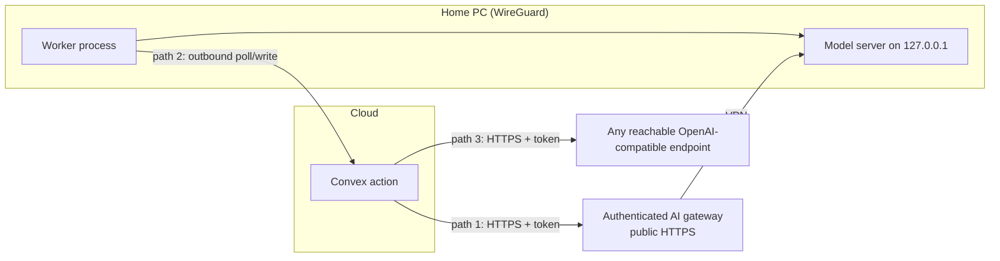

# Starter architecture

Status: implemented, synced with the code · Date: 2026-11-17

This document fixes the architecture of the HackNation engineering starter: a reusable repository
that a small team clones at the start of a 24-hour hackathon. It is the source of truth for
`specs/implementation-plan.md`. Every external fact is cited; the citation list is at the end
(`[S1]`, `[S2]`, …). Versions were read from the npm registry on 2026-11-15.

## 1. Scope

### In scope

- Vite + React + TypeScript (strict) + Tailwind frontend, feature-organised, with a minimal
  homepage and one example feature ("notes").
- Convex backend: schema, one query, one mutation, one action, an idempotent seed function.
- AI provider layer inside Convex: `AIProvider` interface, a deterministic **mock** provider
  (default) and one real **OpenAI-compatible** adapter (path 3 in §6). Paths 1 and 2 are documented only.
- Zod at boundaries: env vars, AI HTTP responses, AI structured output, user form input.
- Tests: Vitest (unit + component), React Testing Library, `convex-test` (backend), Playwright
  smoke; JSON reporters; coverage; per-lane isolation.
- `npm run verify` that equals the PR CI quality job.
- GitHub Actions: PR workflow (verify + gitleaks + one gate job) and main workflow (verify, then
  deploy Convex + Vercel when secrets exist).
- Claude Code configuration: `CLAUDE.md`, two skills, `.claude/settings.json` allowlist, an
  optional typecheck hook, `SETUP_PROMPT.md`.
- Collaboration files: README, CONTRIBUTING, PR template, issue templates, `docs/*.md` (Polish), MIT LICENSE.
- Optional last task: Sentry for the frontend; Convex's built-in Sentry integration documented.

### Out of scope

- Authentication (no Convex Auth, no Clerk). The notes demo is public data; docs say auth is the
  first thing to add before storing anything real.
- Real product features beyond the notes example.
- AI gateway (path 1) and backend worker (path 2) implementations — documented only.
- Streaming responses, tool calling, embeddings, chat history, multi-provider automatic fallback.
- Docker, containers, GHCR (one paragraph in `docs/deployment.md` on how GHCR would be added).
- Full-stack e2e against a live Convex backend (smoke e2e runs frontend-only, see §8.4).
- Dependency update bots (Renovate/Dependabot) — mentioned in docs as a follow-up.
- Branch protection is documented, not configured via API.

## 2. Constraints

- **Time:** the starter must let a team ship an MVP in 24 h; anything not needed for that is out.
- **Platforms:** scripts run on Windows, macOS and Linux. No Bash-only scripts; helpers are
  Node `.mjs` files or cross-platform npm packages.
- **Network:** CI and tests never need a VPN, a personal PC or a live model.
- **Secrets:** nothing secret in the repo or the frontend bundle. Vite exposes only `VITE_*` vars
  to the client, so no secret ever gets a `VITE_` prefix.
- **Team tooling:** plain Claude Code, `gh` CLI, Node, npm. No plugins or extra MCP servers.
- **Languages:** README, `docs/`, CONTRIBUTING, issue/PR templates in Polish; `CLAUDE.md`,
  `SKILL.md`, `SETUP_PROMPT.md`, code, commits in English.

## 3. Assumptions

| #   | Assumption                                                                                                                                    | Consequence if wrong                                                                                                                                              |
| --- | --------------------------------------------------------------------------------------------------------------------------------------------- | ----------------------------------------------------------------------------------------------------------------------------------------------------------------- |
| A1  | The team uses one GitHub repo, possibly owned by an organization.                                                                             | Gitleaks runs as CLI, not via `gitleaks-action`, because the action needs a (free) license key for organization repos [S20].                                      |
| A2  | Vercel and Convex accounts, a GitHub remote and deploy keys will be supplied by the repo owner for the credential-gated tasks.                | Those tasks stop at "documented, not verified".                                                                                                                   |
| A3  | `convex-test@0.0.71` works with Vitest 5. Its own repo still tests on Vitest 1.6 and the Convex docs describe Vitest 4 `projects` [S6].       | Task 04 (first `convex-test` use) pins `vitest`/`@vitest/coverage-v8` to `4.1.12` and records it. **Settled: works on Vitest 5, no pin needed.**                  |
| A4  | Plain `fetch` works in a Convex default-runtime action [S7]; no `"use node"` needed.                                                          | Move the action file to the Node runtime (Node 22/24 supported [S7]). **Settled: works in the default runtime.**                                                  |
| A5  | The model server behind path 3 speaks `/v1/chat/completions`. Structured output support differs per server (§6.4).                            | Adapter falls back to prompt-only JSON mode via config.                                                                                                           |
| A6  | A team of ~5 people, each running several lanes (git worktrees, human or agent) at once: roughly 10–25 lanes team-wide, up to ~8 per machine. | Lanes are cheap to create and clean up (§8.5); the Convex free-plan cap of 40 deployments per team [S8] is the real limit, so lane deployments expire by default. |
| A7  | The typecheck hook stays under ~10 s on the starter.                                                                                          | Hook is dropped and only documented. **Settled: about 4 s, kept.**                                                                                                |
| A8  | The hackathon repo is **public and organization-owned** (decided with the repo owner).                                                        | GitHub merge queue is available only for public org repos or Enterprise Cloud [S34]; on another plan §14 falls back to "update branch + re-run CI before merge".  |

## 4. Stack and versions

### 4.1 Runtime and package manager

**Decision: Node 24 LTS, npm.**

- Node 24 ("Krypton", 24.22.3 on 2026-11-10) and Node 26 ("Lithium") are both LTS [S1].
  Node 24 is chosen because Convex's Node runtime supports 22 and 24, not 26 [S7], and Vercel supports
  22/24/26 [S2]. The strictest dev dependencies set the floor: `jsdom@31.0.1` needs
  `^22.22.2 || ^24.15.0 || >=26.0.0` and `npm-run-all2@9.0.4` needs `^24.15.0` plus `npm >=10` [S3].
  One major for local, CI, Vercel build and any future `"use node"` action avoids surprises.
- `.nvmrc` = `24`; `package.json` `"engines": { "node": ">=24.15.0 <25", "npm": ">=10" }` with
  `engine-strict=true`, so an older 24.x fails at install with a clear message instead of deep
  inside `npm ci`. Vercel maps a range inside 24 to the latest 24.x [S2].
- **npm** (ships with Node; 11.x). Every doc we rely on (Convex, Vercel, Playwright) uses npm; the
  brief's contract is `npm run verify`; pnpm would add a setup step for every newcomer for no
  measurable gain on a starter this size. Lockfile `package-lock.json` is committed; CI uses `npm ci`.
- Versions are pinned **exactly** (`save-exact=true` in `.npmrc`) so every lane and CI resolve the same tree.

### 4.2 Dependencies

Vetting: each package exists in the npm registry under the expected name, links to the expected
repo, has an OSI license and a release within the last 12 months (registry check 2026-11-15 [S3]).
OpenSSF Scorecard via deps.dev where available: react-router 5.3, zod 5.1, playwright 5.6 [S4].

| Package                            | Version   | License    | Why                                                                                                             |
| ---------------------------------- | --------- | ---------- | --------------------------------------------------------------------------------------------------------------- |
| react, react-dom                   | 19.3.1    | MIT        | UI                                                                                                              |
| react-router                       | 8.5.1     | MIT        | Two routes (home, notes) so the smoke test can check navigation. Peer `react >=19.2.7` OK.                      |
| convex                             | 1.50.0    | Apache-2.0 | Backend, React client. Engines `node >=22`.                                                                     |
| zod                                | 4.6.7     | MIT        | Boundary validation; Zod 4 has native `z.toJSONSchema()` used for structured output.                            |
| vite                               | 8.3.8     | MIT        | Dev server/build.                                                                                               |
| @vitejs/plugin-react               | 6.3.0     | MIT        | React for Vite 8.                                                                                               |
| typescript                         | **6.0.3** | Apache-2.0 | Not 7.0.2: `typescript-eslint@8.72.2` declares `typescript >=4.8.4 <6.1.0` [S3]. Revisit when it supports 7.    |
| tailwindcss, @tailwindcss/vite     | 4.3.5     | MIT        | Styling; Vite plugin accepts Vite 8.                                                                            |
| eslint                             | 10.15.0   | MIT        | Lint (flat config).                                                                                             |
| @eslint/js                         | 10.0.1    | MIT        | Recommended rules.                                                                                              |
| typescript-eslint                  | 8.72.2    | MIT        | TS rules (type-aware).                                                                                          |
| eslint-plugin-react-hooks          | 7.1.1     | MIT        | Hooks rules.                                                                                                    |
| eslint-plugin-react-refresh        | 0.5.8     | MIT        | Vite HMR safety.                                                                                                |
| eslint-config-prettier             | 10.1.8    | MIT        | Turn off rules that fight Prettier.                                                                             |
| globals                            | 17.14.0   | MIT        | Browser/node globals for flat config.                                                                           |
| prettier                           | 3.10.1    | MIT        | Formatting.                                                                                                     |
| prettier-plugin-tailwindcss        | 0.8.1     | MIT        | Stable class order; cuts merge noise.                                                                           |
| vitest, @vitest/coverage-v8        | 5.1.0     | MIT        | Unit/component/backend tests, coverage (see A3).                                                                |
| @testing-library/react             | 16.3.3    | MIT        | Component tests.                                                                                                |
| @testing-library/dom               | 10.4.2    | MIT        | Required peer of RTL 16.                                                                                        |
| @testing-library/jest-dom          | 7.0.1     | MIT        | DOM matchers.                                                                                                   |
| @testing-library/user-event        | 14.6.10   | MIT        | Realistic interaction in component tests.                                                                       |
| jsdom                              | 31.0.1    | MIT        | DOM env for component tests.                                                                                    |
| convex-test                        | 0.0.71    | Apache-2.0 | Official Convex mock backend for Vitest [S6]. Pre-1.0 but published by Convex.                                  |
| @edge-runtime/vm                   | 5.0.0     | MIT        | Environment `convex-test` requires [S6].                                                                        |
| @playwright/test                   | 1.65.1    | Apache-2.0 | E2E smoke.                                                                                                      |
| npm-run-all2                       | 9.0.4     | MIT        | Cross-platform sequential script runner for `verify` (`run-s`); `&&` chains behave differently in PowerShell 5. |
| @types/react, @types/react-dom     | 19.3.0    | MIT        | Types.                                                                                                          |
| @types/node                        | 24.19.2   | MIT        | Matches Node 24.                                                                                                |
| @sentry/react, @sentry/vite-plugin | 11.12.0   | MIT        | **Optional task 30 only.**                                                                                      |

Not added, on purpose:

- **`openai` SDK** — considered for the adapter (timeouts, retries, typed errors [S15]). Rejected:
  its 7.57.0 release pulls `esbuild` and `prettier` as runtime dependencies [S3], its fit for the
  Convex default runtime is unconfirmed, and the adapter needs one POST plus normalization
  that differs per server anyway. The adapter is ~100 lines of `fetch` + Zod, fully unit-tested.
- **`dotenv`, `cross-env`** — Vite and the Convex CLI already read `.env.local`; scripts that need
  env read `process.env` directly.
- **`vercel` CLI** — not a dependency; CI calls `npx vercel@65.16.0` (Apache-2.0) [S3].
- **gitleaks** — not an npm package; CI downloads the pinned release binary `v8.30.1` (MIT) and
  checks it against the published checksums file [S21].

### 4.3 TypeScript 6.0 configuration

TypeScript 6.0 changed defaults [S28]: `strict` is `true`, `module` is `esnext`, `target` is the
latest ES version, `rootDir` is the directory of the `tsconfig.json`, `types` is `[]` (no automatic
`@types/*` crawl), `noUncheckedSideEffectImports` is `true`. `baseUrl` and
`moduleResolution: node`/`node10` are deprecated. Consequences for every tsconfig in the repo
(`tsconfig.app.json`, `tsconfig.node.json`, `convex/tsconfig.json`):

- `types` is set explicitly: app → `["vite/client"]` (+ `@testing-library/jest-dom` types for tests),
  node configs → `["node"]`, convex → whatever the generated config needs to compile.
- `strict: true` is still written out (intent is visible), `moduleResolution: "bundler"`, no `baseUrl`.
- No `ignoreDeprecations`; a config that needs it is a bug to fix, because TS 7 removes those options [S28].
- The Convex-generated `convex/tsconfig.json` is kept as generated unless it fails under 6.0; any
  edit is recorded in the task report.

## 5. Repository layout

```
.
├─ .claude/
│  ├─ settings.json            # allowlist (+ optional hook)
│  ├─ hooks/typecheck.mjs      # optional, task 21
│  └─ skills/
│     ├─ apple-design/SKILL.md
│     └─ spec-driven-development/SKILL.md
├─ .github/
│  ├─ workflows/ci.yml         # PR + reusable verify
│  ├─ workflows/deploy.yml     # main → Convex + Vercel
│  ├─ ISSUE_TEMPLATE/{bug_report.md,feature_request.md,config.yml}
│  ├─ hot-files.txt            # shared files that need a contract-first PR (§14)
│  └─ pull_request_template.md
├─ convex/
│  ├─ schema.ts                # HOT: composes per-feature tables, one import line per feature
│  ├─ notes/                   # one folder per backend feature
│  │  ├─ tables.ts             # HOT (data contract): this feature's tables, spread into schema.ts
│  │  ├─ queries.ts            # list            -> api.notes.queries.list
│  │  ├─ mutations.ts          # add             -> api.notes.mutations.add
│  │  ├─ actions.ts            # summarize       -> api.notes.actions.summarize
│  │  ├─ seed.ts               # internalMutation, idempotent
│  │  ├─ limits.ts             # shared note size limits
│  │  └─ *.test.ts
│  ├─ ai/                      # HOT: shared AI layer
│  │  ├─ types.ts              # AIProvider, inputs, results, AIProviderError
│  │  ├─ config.ts             # Zod env schema → ProviderConfig
│  │  ├─ mock.ts
│  │  ├─ openaiCompatible.ts
│  │  └─ index.ts              # getProvider(config)
│  ├─ *.test.ts                # convex-test + adapter unit tests
│  └─ tsconfig.json            # generated by Convex, kept strict
├─ src/
│  ├─ main.tsx, App.tsx, index.css
│  ├─ app/                     # HOT: router (auto-registers features), layout, providers
│  ├─ features/notes/          # feature.tsx (route + nav entry), components, hooks, schema, tests
│  ├─ components/ui/           # a few primitives (Button, Card, Input) — no UI kit
│  ├─ lib/env.ts               # Zod-validated import.meta.env
│  ├─ lib/sentry.ts            # optional Sentry init, off without VITE_SENTRY_DSN
│  └─ test/setup.ts
├─ e2e/smoke.spec.ts
├─ scripts/
│  ├─ lane.mjs                 # lane:new / lane:list / lane:rm (§8.5)
│  ├─ overlap.mjs              # who else touches my files (§14.2)
│  ├─ codegen-check.mjs        # codegen:check (§14.5)
│  ├─ hot-files-check.mjs      # CI hot-files job (§14.3)
│  └─ lib/                     # hot-files.mjs, codegen-check.mjs, proc.mjs, lane-env.mjs
├─ docs/                       # Polish
├─ specs/                      # this file, the plan, and later team specs
├─ CLAUDE.md, SETUP_PROMPT.md, README.md, CONTRIBUTING.md, LICENSE (MIT)
├─ .env.example, .env.e2e (committed, blanks VITE_CONVEX_URL and VITE_SENTRY_DSN for the e2e build, §8.4)
├─ .gitattributes, .gitignore, .nvmrc, .npmrc, .prettierrc.json, .prettierignore
├─ eslint.config.js, vite.config.ts, vitest.config.ts, playwright.config.ts
├─ tsconfig.json, tsconfig.app.json, tsconfig.node.json
├─ vercel.json
└─ package.json, package-lock.json
```

Rules: business logic lives in `convex/` (or pure helpers in `convex/lib/`), never in React
components. A feature owns `src/features/<name>/` and `convex/<name>/`; adding a feature should
add files, not edit shared ones (§14). Shared code moves to `components/ui`, `lib` or
`convex/lib` only when a second feature needs it, through a contract-first PR.

### 5.1 Convex code generation

- `convex/_generated/` is committed, as Convex projects normally do, so a fresh clone typechecks
  without a deployment. Every `.ts` file under `convex/` is a module and appears in
  `_generated/api.d.ts`.
- The generated API mirrors file paths: `convex/notes/queries.ts` exports `list` as
  `api.notes.queries.list`. Files inside a feature folder are named by role (`queries.ts`,
  `mutations.ts`, `actions.ts`, `seed.ts`, `tables.ts`) so references read naturally.
- Regenerating: `npx convex codegen` needs a configured deployment, even though it only reads
  `convex/` [S37]. An anonymous local one is enough:
  `CONVEX_AGENT_MODE=anonymous npx convex dev --once`. `npm run codegen:check` also uploads the
  functions to that deployment, so it runs locally and in lanes, not in CI.
- **Rule:** any task that adds, renames or removes a file under `convex/` regenerates
  `_generated` in the same commit. Such tasks run **sequentially**, because two branches that both
  regenerate `_generated` conflict on merge (resolved by regenerating, §14.5).
- Files pushed to Convex must bundle in the default runtime: no Node-only imports, and no
  `vitest` import outside `*.test.ts`. Tests live next to the code (`convex/notes/*.test.ts`); `convexTest`
  gets its modules from the root-absolute glob `import.meta.glob("/convex/**/*.*s")`.

## 6. AI provider architecture

### 6.1 Where it runs

All AI calls run in **Convex actions** (actions may call `fetch`; queries/mutations may not [S7];
default-runtime actions may run up to 30 min [S8]). The frontend never talks to a model and never
sees a key. Configuration comes from **Convex deployment env vars** (`npx convex env set …`, read
via `process.env` [S9]), so dev, preview and prod can point at different providers.

### 6.2 Interface

```ts
// convex/ai/types.ts (shape, not final code)
interface AIProvider {
  generateText(input: {
    prompt: string;
    system?: string;
    maxTokens?: number;
  }): Promise<TextResult>;
  generateStructuredOutput<T>(input: {
    prompt: string;
    system?: string;
    schema: z.ZodType<T>;
    schemaName: string;
  }): Promise<StructuredResult<T>>;
  getProviderInfo(): {
    id: "mock" | "openai-compatible";
    model: string;
    baseUrlHost?: string;
  };
}
type TextResult = {
  text: string;
  usage?: { inputTokens?: number; outputTokens?: number };
  provider: string;
  model: string;
};
class AIProviderError extends Error {
  code:
    | "config"
    | "timeout"
    | "unavailable"
    | "auth"
    | "rate_limited"
    | "bad_response";
  retryable: boolean;
}
```

Separation required by the brief: **configuration** (`config.ts`, Zod), **model selection**
(`AI_MODEL`), **request handling + timeouts + retries** (`openaiCompatible.ts`), **response
normalization** (to `TextResult`), **error handling** (`AIProviderError`), **usage metadata**
(when the server returns `usage`).

### 6.3 Providers

- **mock** (default; `AI_PROVIDER=mock` or unset). Deterministic: same input → same output.
  Scenarios selected by a prompt prefix so tests and demos can force them: `[mock:error]` →
  `unavailable`, `[mock:timeout]` → `timeout`, otherwise a canned Polish summary derived from the
  input length/first words. Structured output returns a fixture registered per `schemaName`,
  validated by the given schema; unknown `schemaName` → `config` error.
- **openai-compatible** (path 3). `POST {AI_BASE_URL}/chat/completions` with
  `Authorization: Bearer {AI_API_KEY}`, `AbortSignal.timeout(AI_TIMEOUT_MS)`, retries on network
  errors, 429 and 5xx up to `AI_MAX_RETRIES` with exponential backoff (500 ms × 2ⁿ). Response
  parsed with a Zod schema of the chat-completions shape; anything else → `bad_response`.
  401/403 → `auth`, never retried. 404 and 400/422 carry hints (check that `AI_BASE_URL` ends with
  `/v1`; try another `AI_STRUCTURED_MODE`). Config caps: `AI_TIMEOUT_MS` ≤ 120000,
  `AI_MAX_RETRIES` ≤ 3; credentials inside `AI_BASE_URL` are rejected, and plain `http` is allowed
  only for `localhost`/`127.0.0.1`.

No automatic fallback from a real provider to another real provider. If the real provider fails,
the action returns a typed error and the UI shows "AI niedostępne" while the rest of the app works.
Switching to the mock is an explicit config change (`AI_PROVIDER=mock`).

### 6.4 Structured output across servers

Servers differ, so the adapter has `AI_STRUCTURED_MODE`:

| Mode                    | Request                                                                                                   | Known support                                                                                                                   |
| ----------------------- | --------------------------------------------------------------------------------------------------------- | ------------------------------------------------------------------------------------------------------------------------------- |
| `json_schema` (default) | `response_format: { type: "json_schema", json_schema: { name, schema } }`, schema from `z.toJSONSchema()` | vLLM: `json_object`, `json_schema` [S11]. llama.cpp: schema-constrained JSON [S12]. Ollama `/v1` maps `json_schema` [S13][S38]. |
| `json_object`           | `response_format: { type: "json_object" }` + schema in the system prompt                                  | vLLM [S11]; Ollama maps `response_format` `json_object` too [S13].                                                              |
| `prompt`                | schema in the system prompt only                                                                          | Any server.                                                                                                                     |

In every mode the reply is `JSON.parse`d and validated with the Zod schema; failure → `bad_response`.

### 6.5 Bielik and PLLuM

- **Bielik 11B v3.0 Instruct** (SpeakLeash): Apache-2.0, gated on Hugging Face, ChatML template
  with system role; documented serving: `vllm serve speakleash/Bielik-11B-v3.0-Instruct` exposing
  `/v1/chat/completions`, also SGLang and Docker Model Runner [S10]. GGUF builds and an Ollama
  model `SpeakLeash/bielik-11b-v3.0-instruct` exist; SpeakLeash warns that quantised builds lose
  quality [S14]. No documented tool-calling or structured-output guarantees [S10].
- **PLLuM** (CYFRAGOVPL): model cards list vLLM serving with an OpenAI-compatible endpoint [S16].
  **Licenses differ per model** — Apache-2.0, CC-BY-NC-4.0 (`-nc` variants, non-commercial) or the
  Llama 3.1 license; some repos are gated [S16]. `docs/ai-providers.md` tells the team to check the card.
- **Servers:** vLLM `--api-key`/`VLLM_API_KEY` protects only `/v1`, `/v2`, `/inference`,
  `/cohere`; the vLLM docs say not to rely on it alone [S11]. llama.cpp server binds `127.0.0.1` by
  default and supports `--api-key` [S12]. Ollama ignores the API key locally [S13] — so Ollama
  must never be exposed beyond localhost without an authenticating proxy in front.

### 6.6 Network paths (Bielik on a PC behind WireGuard)

Convex cloud functions cannot reach a private WireGuard address. Three paths:



1. **Gateway (documented):** a small authenticated reverse proxy on a reachable host (VPS inside
   the WireGuard mesh, or a tunnel product) terminates TLS, checks a bearer token, rate-limits and
   forwards to the model over the VPN. To Convex it is just path 3 with `AI_BASE_URL` = gateway URL.
   Requirements: TLS, token auth, request size/time limits, no direct model port exposure.
2. **Worker (documented):** a process on the PC (inside the VPN) uses the Convex client to pick up
   pending AI jobs from a Convex table and write results back via mutations. Only outbound traffic;
   nothing is exposed. Requirements: a `jobs` table + claim/complete mutations, a deploy key or
   auth for the worker, a status field the UI subscribes to. Fits Convex's reactive model.
3. **Direct OpenAI-compatible endpoint (implemented):** `AI_BASE_URL`, `AI_API_KEY`, `AI_MODEL`
   point at any reachable, authenticated server (hosted Bielik/PLLuM, a cloud vLLM, a gateway).

Never open a model port to the internet to make an integration work.

## 7. Environment and secrets

| Where                                 | Variable                                                                            | Secret                | Purpose                                                                                                            |
| ------------------------------------- | ----------------------------------------------------------------------------------- | --------------------- | ------------------------------------------------------------------------------------------------------------------ |
| Frontend (`.env.local`, Vercel build) | `VITE_CONVEX_URL`                                                                   | no                    | Convex deployment URL. `convex deploy --cmd … --cmd-url-env-var-name VITE_CONVEX_URL` sets it at build time [S17]. |
| Frontend                              | `VITE_SENTRY_DSN`                                                                   | no (public by design) | Optional, task 30.                                                                                                 |
| Frontend (build)                      | `VITE_COMMIT_SHA`                                                                   | no                    | Release id for Sentry, set by `deploy.yml`.                                                                        |
| Local only                            | `CONVEX_DEPLOYMENT`                                                                 | no                    | Written to `.env.local` by `npx convex dev` [S17].                                                                 |
| Convex env (per deployment)           | `AI_PROVIDER`                                                                       | no                    | `mock` (default) \| `openai-compatible`.                                                                           |
| Convex env                            | `AI_BASE_URL`, `AI_MODEL`                                                           | no                    | Required when provider is `openai-compatible`.                                                                     |
| Convex env                            | `AI_API_KEY`                                                                        | **yes**               | Bearer token for the endpoint/gateway.                                                                             |
| Convex env                            | `AI_TIMEOUT_MS` (20000), `AI_MAX_RETRIES` (1), `AI_STRUCTURED_MODE` (`json_schema`) | no                    | Defaults in brackets.                                                                                              |
| GitHub secrets                        | `CONVEX_DEPLOY_KEY`                                                                 | **yes**               | Production deploy key [S5].                                                                                        |
| GitHub secrets                        | `VERCEL_TOKEN`, `VERCEL_ORG_ID`, `VERCEL_PROJECT_ID`                                | token yes             | Vercel CLI deploy [S18].                                                                                           |
| GitHub secrets                        | `SENTRY_AUTH_TOKEN`                                                                 | **yes**               | Optional, source map upload.                                                                                       |
| GitHub variables                      | `SENTRY_ORG`, `SENTRY_PROJECT`                                                      | no                    | Optional, source map upload; variables, not secrets.                                                               |

- Frontend env is parsed by `src/lib/env.ts` (Zod). Missing `VITE_CONVEX_URL` is **not** an error:
  the app renders in "offline mode" with a banner; this keeps the e2e smoke test and first-run
  experience backend-free.
- Backend AI config is parsed by `convex/ai/config.ts` when the action runs (not at module load),
  so a missing var yields a `config` error in that action only.
- `.env.example` lists every variable with comments; `.env*.local` is gitignored.
- No hardcoded IPs, hostnames or keys anywhere; tests use `https://ai.test.invalid`.

## 8. Testing strategy

### 8.1 Layers

| Layer                                       | Tool                                 | Location                                  | Env                          |
| ------------------------------------------- | ------------------------------------ | ----------------------------------------- | ---------------------------- |
| Unit (pure logic, Zod schemas, AI adapters) | Vitest                               | `src/**/*.test.ts`, `convex/**/*.test.ts` | node / edge-runtime          |
| Component                                   | Vitest + RTL + jest-dom + user-event | `src/**/*.test.tsx`                       | jsdom                        |
| Backend integration                         | Vitest + `convex-test`               | `convex/**/*.test.ts`                     | `edge-runtime` [S6]          |
| E2E smoke                                   | Playwright (Chromium only)           | `e2e/`                                    | built app via `vite preview` |

### 8.2 Vitest config

One `vitest.config.ts` with two `projects` [S6]: `frontend` (jsdom, `src/**`) and `backend`
(`edge-runtime`, `convex/**`). `convexTest(schema, modules)` with
`const modules = import.meta.glob("./**/*.ts")` in the convex folder [S6].

- AI adapter tests stub `fetch` with `vi.stubGlobal` [S6]; no network.
- `convex-test` limits noted in `docs/testing.md`: error text may differ from prod, limits not
  enforced, no cron support [S6].

### 8.3 Reporters and coverage

- Vitest: `default` + `json` reporter → `reports/vitest.json`.
- Playwright: `list` + `json` → `reports/playwright.json`; `html` only when not in CI.
- Coverage: v8, `text-summary` + `lcov` + `json-summary` → `coverage/`. **No threshold** at start;
  `docs/testing.md` explains how to add `thresholds` once the product stabilises.
- `reports/`, `coverage/`, `playwright-report/`, `test-results/` are gitignored and uploaded as CI artifacts.

### 8.4 E2E smoke scope

The smoke test must give the same result on a laptop that has run `npx convex dev` (which writes
`VITE_CONVEX_URL` to `.env.local`) and in CI (which has no `.env.local`). Vite loads `.env` and
`.env.local` in every mode, but **mode-specific files take precedence over generic ones**, and
shell variables beat all files [S30]. So:

- The e2e bundle is built in its own mode: `vite build --mode e2e --outDir dist-e2e`. The committed
  `.env.e2e` sets `VITE_CONVEX_URL=` and `VITE_SENTRY_DSN=` (empty), which override `.env.local`; `src/lib/env.ts` treats
  an empty value as unset. `dist-e2e/` is gitignored and excluded from lint/format.
- Playwright's `webServer` runs that build and then
  `vite preview --mode e2e --outDir dist-e2e --port $PREVIEW_PORT --strictPort`.
- If `VITE_CONVEX_URL` is exported in the shell, the e2e script fails fast with a clear message
  instead of silently testing online mode.
- Frontend unit/component tests never depend on the developer's env: anything that cares about
  online/offline uses `vi.stubEnv` [S6 shows the `vi` stubbing pattern].

Smoke scope, offline mode: page loads, heading renders, offline banner is visible, navigation
works. Task 10 extends it with notes navigation and the empty-submit Zod validation error.
Full-stack e2e against a Convex backend is out of scope (documented as a follow-up).

### 8.5 Per-lane isolation

A lane = one git worktree with one owner (a person or an agent). With ~5 people each running
several lanes (A6) this has to be one command, not a convention people remember.

- **Ports (per machine):** ports only clash on the same machine, so lanes are numbered per
  machine. `vite.config.ts` reads `PORT` (dev, default 5173) and `PREVIEW_PORT` (preview/e2e,
  default 4173) from the process env or the worktree's `.env.local`; both `strictPort: true` so a
  clash fails loudly. Vite config and Playwright share `scripts/lib/lane-env.mjs`, which parses
  `.env.local` with `util.parseEnv` (never `process.loadEnvFile`, which would write into
  `process.env` and override the shell).
- **Convex (per lane):** each member has one personal cloud dev deployment by default; extra
  isolated dev deployments are created with
  `npx convex deployment create dev/<member>/<lane> --type dev --select --expiration "in 7 days"`,
  which writes that worktree's `.env.local` [S31][S32]. Convex suggests exactly this per agent
  worktree [S31]. Every deployment counts toward the team limit: 40 on Free/Starter, 300 on
  Professional [S8]. 5 members + prod + ~25 lanes fits under 40 only if finished lanes are
  removed or expire, hence the default expiry. A **local** deployment (`reference = local`,
  beta, state in `.convex/`, uses no quota) is the fallback when the team is near the cap
  [S22][S32].
- **Lane script:** `npm run lane:new -- <member> <issue> <slug>` (cross-platform
  `scripts/lane.mjs`): creates `../<repo>-<issue>-<slug>` as a git worktree on branch
  `feat/<issue>-<slug>` (the repo's branch rule), runs `npm ci` in it (prints that it takes a
  minute or two) so every later `npx convex` uses the pinned `convex@1.50.0` from that worktree's
  `node_modules` instead of downloading the latest, picks the first free lane number on this
  machine, creates and selects the Convex dev deployment `dev/<member>/<issue>-<slug>` (or
  `--local`), then adds `PORT`/`PREVIEW_PORT` to the worktree's `.env.local`. Cloud lanes need
  `npx convex login`; `--local` runs anonymously (`CONVEX_AGENT_MODE=anonymous`) without login.
  `npm run lane:list` shows lanes with ports and deployments; `npm run lane:rm -- <slug>` removes
  the worktree and prints a hint: delete the cloud deployment in the dashboard or let it expire
  (convex 1.50 has no `deployment delete`); local state goes with the worktree.
- **Reports:** written inside the worktree, so lanes never overwrite each other.

### 8.6 `npm run verify`

`run-s format:check lint typecheck test:coverage build test:e2e` — exactly the CI `verify` job.
`build` checks the production bundle compiles; `test:e2e` builds its own `e2e`-mode bundle (§8.4),
so a local `.env.local` cannot change the outcome.
Gitleaks is the one CI-only step (a Go binary, not an npm package); `docs/testing.md` shows how to
run it locally if installed.

## 9. Scripts

| Script                                  | Command (intent)                                                                                          |
| --------------------------------------- | --------------------------------------------------------------------------------------------------------- |
| `dev`                                   | `convex dev --start "vite"` when Convex is configured; docs also show `vite` alone for frontend-only work |
| `dev:frontend`                          | `vite`                                                                                                    |
| `build`                                 | `tsc -b && vite build`                                                                                    |
| `preview`                               | `vite preview`                                                                                            |
| `lint`                                  | `eslint .`                                                                                                |
| `format` / `format:check`               | `prettier --write .` / `prettier --check .`                                                               |
| `typecheck`                             | `tsc -b` covering app, node configs and `convex/`                                                         |
| `test` / `test:watch` / `test:coverage` | `vitest run` / `vitest` / `vitest run --coverage`                                                         |
| `test:e2e`                              | `playwright test` (its `webServer` builds and serves the `e2e`-mode bundle, §8.4)                         |
| `seed`                                  | `convex run notes/seed:run`                                                                               |
| `lane:new` / `lane:list` / `lane:rm`    | `node scripts/lane.mjs …` (§8.5)                                                                          |
| `overlap`                               | `node scripts/overlap.mjs` (§14.2)                                                                        |
| `codegen:check`                         | `convex codegen` then fail if `convex/_generated` differs from what is committed (§14.5)                  |
| `verify`                                | `run-s format:check lint typecheck test:coverage build test:e2e` (§8.6)                                   |

Helper scripts in `scripts/` are plain `.mjs` (run by Node with no build step) typed with JSDoc;
`tsconfig.node.json` includes `scripts/**` with `allowJs` + `checkJs`, so `npm run typecheck`
checks them and their `.test.ts` files under the same strict settings.

## 10. CI/CD

### 10.1 `ci.yml` — pull requests (+ `workflow_call` for reuse)

- Triggers: `pull_request` to `main`, `merge_group`, `workflow_call`.
- `permissions: contents: read` at top.
- Concurrency is set on the **jobs**, not at workflow level, because when `deploy.yml` calls this
  file `github.workflow` and `github.event_name` are the caller's, and a group equal to the
  caller's deadlocks. Group: `ci-${{ github.event_name }}-${{ github.ref }}-<job>`,
  `cancel-in-progress: ${{ github.event_name == 'pull_request' }}`. `deploy.yml` uses a
  different prefix (`deploy-production`).
- All actions pinned to full commit SHAs (comment with the tag).
- Jobs:
  - `verify`: checkout → setup-node (from `.nvmrc`, npm cache) → `npm ci` → cache + install
    Playwright Chromium → `npm run verify` → upload `reports/`, `coverage/` artifacts (always).
  - `secrets`: checkout with full history → download gitleaks `v8.30.1` linux_x64 + checksums,
    verify checksum → `gitleaks git --redact` (exit non-zero on findings).
  - `hot-files` (pull_request only): fails if the PR touches a hot file **and** non-hot files
    without the acknowledged checkbox in the **live** PR body (§14.3). It restores the checker
    and `.github/hot-files.txt` from the base commit, so a PR cannot weaken its own check, and
    fails closed if the base commit is unreachable. The diff uses `--no-renames`, so a rename
    counts as a delete plus an add.
  - `gate`: `needs: [verify, secrets, hot-files]`, `if: always()`. Passes only when `verify` and
    `secrets` are `success`, and `hot-files` is `success` — or `skipped` **only** when
    `github.event_name != 'pull_request'` (merge_group, workflow_call). **The only required status
    check** in branch protection; it also runs on `merge_group`, so the merge queue uses it.
  - No `edited` trigger: editing a PR body must never produce a run in which `verify` is skipped
    and `gate` is green for the same commit.
- No deploys from PRs.

### 10.2 `deploy.yml` — main

- Trigger: `push` to `main` (and `workflow_dispatch`). `concurrency: deploy-production`, no cancel.
- `verify`: `uses: ./.github/workflows/ci.yml`; the caller grants `contents: read` and
  `pull-requests: read`, because a called workflow cannot exceed the caller's permissions.
- `deploy` (`needs: verify`, `environment: production`). Secrets are scoped per step (`env:` on
  the step that needs them), never job-wide. Steps:

  1. Check that `CONVEX_DEPLOY_KEY`, `VERCEL_TOKEN`, `VERCEL_ORG_ID`, `VERCEL_PROJECT_ID` are set;
     if any is missing, write a notice to the job summary and stop with success (the starter must
     be green before anyone has accounts).
  2. `npx vercel@65.16.0 pull --yes --environment=production` [S18].
  3. `npx convex deploy --cmd "npx vercel@65.16.0 build --prod" --cmd-url-env-var-name VITE_CONVEX_URL`
     — Convex deploys functions and the Vercel build receives the right URL [S17][S5].
  4. Guard: search `.vercel/output/static` for the production Convex URL host (from the
     `convex deploy` output / deploy key's deployment) and fail if it is missing. No cited source
     documents `convex deploy --cmd "vercel build"` combined with `vercel pull`, and whether the
     injected `VITE_CONVEX_URL` beats a value pulled into `.vercel/.env.production.local` is not
     documented, so the pipeline checks the result instead of trusting it.
  5. `npx vercel@65.16.0 deploy --prebuilt --prod` [S18].

- `VITE_CONVEX_URL` is **never** set in the Vercel project env; `docs/deployment.md` says so.
- `vercel.json`: `{ "git": { "deploymentEnabled": false } }` so Vercel's Git integration does not
  deploy a second time [S18]. Vercel preview deploys are therefore off; documented how to turn them
  back on with a Convex preview deploy key [S5].

### 10.3 Branch protection (documented)

`main`: require PR, require the `gate` check, **require merge queue** (A8, §14.4), squash merge
only, no force push, no wildcard pattern (a merge queue cannot use one [S35]). No required approval
count (small team).

## 11. Claude Code configuration

- **Skills:** `.claude/skills/<name>/SKILL.md`, YAML frontmatter on line 1 with `name` and
  `description` (description is what triggers auto-loading; keep key use first, ≤1,536 chars with
  `when_to_use`; file under 500 lines) [S23]. Written from scratch, about one page each.
- **`.claude/settings.json`** (strict JSON, `$schema` line) [S24]. Rule matching facts [S29]:
  the space before a trailing `*` is part of the rule (`Bash(npm run test *)` does **not** match
  `npm run test:coverage`); deny is evaluated before allow and an allow rule cannot carve an
  exception out of a deny rule; inside one `deny` list a `!` pattern listed after a rule is a
  gitignore negation that carves paths out of it.
  - `allow` lists each script explicitly: `Bash(npm run verify)`, `Bash(npm run lint)`,
    `Bash(npm run typecheck)`, `Bash(npm run build)`, `Bash(npm run test)`,
    `Bash(npm run test:coverage)`, `Bash(npm run test:e2e)`, `Bash(npm run format)`,
    `Bash(npm run format:check)`, plus read-only `Bash(git status)`, `Bash(git diff *)`,
    `Bash(git log *)`, `Bash(gh issue view *)`, `Bash(gh issue list *)`, `Bash(gh pr view *)`,
    `Bash(gh pr diff *)`, `Bash(gh pr checks *)`, `Bash(gh pr list *)`, `Bash(npm run overlap)`,
    `Bash(npm run overlap *)`, `Bash(git fetch *)`. (`test:watch` is excluded: it never exits.)
  - `deny`, in this order: `Read(./.env)`, `Read(./.env.*)`, `Read(!.env.example)`, `Read(!.env.e2e)`
    — the two committed, non-secret env files stay readable.
  - Allow rules apply only after each teammate trusts the folder; deny rules apply immediately [S24].
- **Optional hook** [S25]: `PostToolUse`, matcher `Edit|Write`, runs `.claude/hooks/typecheck.mjs`
  (Node, cross-platform) which runs `tsc -b --pretty false` and exits `2` with errors on stderr so
  Claude sees them. `CLAUDE_PROJECT_DIR` locates the script [S25]. Kept only if ≤ ~10 s (A7).
- **`CLAUDE.md`:** the items in brief §4, including light hackathon mode (1-page spec in
  `specs/<feature>.md` → implement → a separate reviewer subagent checks the diff against the
  acceptance criteria), GitHub Issues as task source, language rule. No `AGENTS.md`.
  `CLAUDE.md` itself (not only `docs/`) carries the agent rules from the brief §6, because agents
  load it every session: use `gh` only and `gh auth login` is the only auth path; branch naming
  `feat|fix|chore/<n>-<slug>`; `Closes #<n>` in every PR; never create or close issues or change
  labels/milestones without asking (comments are fine).

## 12. Error tracking (optional, last)

- Frontend: `@sentry/react` initialised only when `VITE_SENTRY_DSN` is set; `beforeSend` strips
  request bodies and anything under AI-related keys; source maps uploaded by `@sentry/vite-plugin`
  only when `SENTRY_AUTH_TOKEN` is present at build time.
- Backend: Convex's built-in Sentry integration (dashboard → Integrations, Pro plan only, adds
  `func`, `environment`, … tags) [S26] — documented, no code.

## 13. Acceptance criteria (whole starter)

1. WHEN a developer follows README on a clean machine with Node 24 THEN `npm ci && npm run dev:frontend` SHALL serve the app in offline mode in < 10 min of setup.
2. WHEN `npx convex dev` has configured a deployment THEN the notes page SHALL list, add and summarize notes (mock provider) end to end.
3. WHEN `npm run verify` runs on a clean checkout THEN format, lint, typecheck, tests with coverage, build and e2e smoke SHALL pass, and `reports/vitest.json`, `reports/playwright.json`, `coverage/` SHALL exist. The same SHALL hold when a `.env.local` with a `VITE_CONVEX_URL` is present.
4. WHEN `AI_PROVIDER` is unset THEN the mock provider SHALL be used and no network call SHALL be made.
5. WHEN the openai-compatible endpoint times out, refuses, returns 401 or malformed JSON THEN the action SHALL return a typed error and the UI SHALL stay usable; this SHALL be covered by tests with stubbed `fetch`.
6. WHEN a PR is opened THEN `ci.yml` SHALL run verify and gitleaks and report one `gate` result; no deploy SHALL run.
7. WHEN main is pushed and all four deploy secrets exist THEN Convex and Vercel production SHALL be deployed; IF any is missing THEN the job SHALL succeed with a notice.
8. WHEN `actionlint` runs on `.github/workflows/` THEN it SHALL report no errors.
9. WHEN grepping tracked files for the names of builder-only tools the team does not have (term list kept outside the repo) THEN there SHALL be zero hits.
10. WHEN Claude Code starts in the repo THEN both skills SHALL appear and the allowlisted commands SHALL run without prompts (after folder trust).
11. Docs listed in brief §12 SHALL exist in Polish, README covering every topic listed there.
12. IF Sentry is not configured THEN the app SHALL behave identically to a build without Sentry.
13. WHEN a new feature is added following `docs/architecture.md` THEN it SHALL take at most two PRs: a contract PR with only hot files (`convex/<name>/tables.ts` + one import line in `convex/schema.ts`, if the feature has data), then a feature PR with only new files under `src/features/<name>/` and `convex/<name>/` — neither needing the acknowledgement checkbox.
14. WHEN two open PRs or local lanes change the same file THEN `npm run overlap` SHALL list it, marking hot files.
15. WHEN a PR mixes hot and non-hot files without the acknowledgement THEN the `gate` check SHALL fail.

## 14. Parallel work and merge conflicts

Five people with several lanes each (A6) will touch the same code unless the starter makes that
rare, visible early, and cheap to fix. Four layers, cheapest first.

### 14.1 Layout: features add files, not edits

- **Frontend auto-registration.** Each feature exports `src/features/<name>/feature.tsx`
  (`{ path, navLabel, order, element }`). `src/app/router.tsx` collects them with
  `import.meta.glob("../features/*/feature.tsx", { eager: true })` [S33] and builds routes and nav
  from the result. A new page never edits the router or the layout.
- **Backend feature folders.** `convex/<name>/` holds the feature's `tables.ts`, functions, seed
  and tests. `convex/schema.ts` spreads each feature's tables (`...notesTables`), one import line per
  feature; Convex bundles with its own bundler, so the Vite glob trick does not apply there and
  `schema.ts` stays a hot file.
- **Schema changes stay additive** during the hackathon (new tables, new optional fields). Renaming
  or removing a field is a contract-first change, because every lane has its own dev deployment and
  the clash otherwise shows up first at the production deploy.

### 14.2 Visibility: know who touches what before you start

- **Claim = issue assignee.** One issue per piece of work; the person (not the agent) assigns
  themselves. Issue templates have a "Planowany zakres plików" field.
- **`npm run overlap`** (`scripts/overlap.mjs`, Node built-ins + `git` + `gh`): compares the
  files changed on my branch (or `--paths <globs>` I plan to touch) with
  (a) every open PR via `gh pr list --state open --json number,title,author,headRefName,files`
  [S36] and (b) every other local worktree's diff against `origin/main`. Prints overlaps grouped by
  file, marks hot files. Informational (exit 0) by default, `--strict` exits 1 on any hot-file
  overlap. Agents run it before starting work and before opening a PR; on a hot-file overlap
  they stop and ask the human.
- **Hot-file list** lives in `.github/hot-files.txt` (gitignore-style globs): `convex/schema.ts`,
  `convex/*/tables.ts` (tables are the data contract, which also enforces "additive only" through
  review), `convex/ai/**`, `convex/lib/**`, `src/app/**`, `src/components/ui/**`, `src/lib/**`,
  `package.json`, `package-lock.json`, root config files, `.github/**`, `.claude/**`, `CLAUDE.md`.
  The script, the CI job and `CLAUDE.md` all read or point to this one file.
- **Derived files are exempt:** `convex/_generated/**` counts as neither hot nor non-hot. It is
  regenerated output that rides along with whatever change produced it, so it never makes a PR
  "mixed" on its own.
- **Adding a dependency is a hot-file change** (`package.json` + lockfile): it goes in a contract
  PR, after vetting the package (exists in the registry under the expected name, OSI license,
  maintained, no known vulnerabilities) and a quick word with the team. Agents propose it and
  wait; they do not `npm install` inside a feature branch.

### 14.3 Contract-first rule for hot files

A change to a hot file goes in **its own small PR** (branch `chore/<n>-contract-<slug>`, title
`feat(contract): …`), containing only the hot-file change and its tests, merged before the feature
work that needs it. Teammates rebase onto it. Agents must ask a human before editing a hot file
inside a feature PR.

Typical backend feature: PR 1 (contract) = `convex/<name>/tables.ts` + the import line in
`convex/schema.ts` (plus regenerated `convex/_generated/**`, exempt per §14.2, and the contract's
own tests); PR 2 (feature) = queries/mutations/actions/tests and the frontend folder. Both pass
`hot-files` without any acknowledgement.

Escape hatch for genuinely tiny mixed cases: the PR template checkbox
"`- [x] Zmiana plików wspólnych uzgodniona z zespołem`". Ticking a box is an `edited` event,
which does not re-run CI, and a re-run reuses the old event payload. So the `hot-files` job reads
the **live** body with `gh pr view <n> --json body` (job `permissions: pull-requests: read`,
`GH_TOKEN: ${{ github.token }}`), and the PR template and docs say: tick the box, then press
**Re-run failed jobs** (it re-runs `hot-files` and the dependent `gate`).

### 14.4 Integration: catch conflicts at merge, not at the demo

- **Merge queue on `main`** (A8). Each PR is re-tested on top of the latest `main` plus the PRs
  ahead of it, so two individually green PRs that break each other never both land [S35]. Requires
  the `merge_group` trigger, which `ci.yml` already has [S35].
- **Squash merge only**: one commit per PR on `main`, trivial to revert.
- **Short branches**: aim for PRs under ~4 hours of work; `git fetch && git rebase origin/main`
  at least every couple of hours and before opening a PR. Documented in CONTRIBUTING and CLAUDE.md.

### 14.5 Cheap conflict resolution for generated files

- `.gitattributes`: `* text=auto eol=lf` so Windows teammates don't produce whole-file line-ending
  conflicts; `package-lock.json` and `convex/_generated/**` marked `linguist-generated=true`
  (collapsed in PR diffs).
- Recipes in `docs/development-workflow.md`: lockfile conflict → take `main`'s version, run
  `npm install`; `_generated` conflict → take either side, run `npx convex codegen`.
- `npm run codegen:check` runs `npx convex codegen` and fails if the result differs from the
  committed files; the Convex CLI's own help names this CI use [S37]. Whether it runs without a
  configured deployment is verified in task 33; if it needs one, the check runs only locally and
  in lanes, not in CI.
- Prettier with `format:check` in `verify` already removes formatting-only conflicts.

## 15. Sources

- [S1] Node.js release index — https://nodejs.org/dist/index.json (fetched 2026-11-15)
- [S2] Vercel, Supported Node.js versions — https://vercel.com/docs/functions/runtimes/node-js/node-js-versions
- [S3] npm registry metadata (`https://registry.npmjs.org/<pkg>/latest`), fetched 2026-11-15 for every package in §4.2
- [S4] deps.dev project API (OpenSSF Scorecard) — https://api.deps.dev/v3/projects/github.com%2Fremix-run%2Freact-router (and zod, playwright)
- [S5] Convex, Using Convex with Vercel — https://docs.convex.dev/production/hosting/vercel
- [S6] Convex, convex-test — https://docs.convex.dev/testing/convex-test
- [S7] Convex, Runtimes — https://docs.convex.dev/functions/runtimes
- [S8] Convex, Limits — https://docs.convex.dev/production/state/limits
- [S9] Convex, Environment variables — https://docs.convex.dev/production/environment-variables
- [S10] Bielik 11B v3.0 Instruct model card — https://huggingface.co/speakleash/Bielik-11B-v3.0-Instruct
- [S11] vLLM, OpenAI-compatible server — https://docs.vllm.ai/en/latest/serving/online_serving/openai_compatible_server/
- [S12] llama.cpp server README — https://github.com/ggml-org/llama.cpp/blob/master/tools/server/README.md
- [S13] Ollama, OpenAI compatibility — https://docs.ollama.com/api/openai-compatibility
- [S14] Bielik 11B v3.0 Instruct GGUF — https://huggingface.co/speakleash/Bielik-11B-v3.0-Instruct-GGUF
- [S15] openai-node README — https://github.com/openai/openai-node
- [S16] PLLuM model cards — https://huggingface.co/CYFRAGOVPL/PLLuM-12B-chat and https://huggingface.co/CYFRAGOVPL/PLLuM-12B-chat-2412
- [S17] Convex CLI — https://docs.convex.dev/cli and `npx convex@1.50.0 deploy --help` (flags `--cmd`, `--cmd-url-env-var-name`)
- [S18] Vercel, How can I use GitHub Actions with Vercel — https://vercel.com/kb/guide/how-can-i-use-github-actions-with-vercel
- [S19] `npx convex@1.50.0 dev --help` (flags `--once`, `--configure`, `--dev-deployment local|cloud`, `--env-file`), run 2026-11-15
- [S20] gitleaks-action README — https://github.com/gitleaks/gitleaks-action
- [S21] gitleaks releases (v8.30.1, MIT, checksums file) — https://github.com/gitleaks/gitleaks/releases/tag/v8.30.1
- [S22] Convex, Local deployments — https://docs.convex.dev/cli/local-deployments
- [S23] Claude Code, Skills — https://code.claude.com/docs/en/skills
- [S24] Claude Code, Settings — https://code.claude.com/docs/en/settings
- [S25] Claude Code, Hooks — https://code.claude.com/docs/en/hooks
- [S26] Convex, Exception reporting — https://docs.convex.dev/production/integrations/exception-reporting
- [S27] Convex, React quickstart (`ConvexReactClient`, `VITE_CONVEX_URL`) — https://docs.convex.dev/quickstart/react
- [S28] Announcing TypeScript 6.0 (changed defaults, deprecations) — https://devblogs.microsoft.com/typescript/announcing-typescript-6-0/
- [S29] Claude Code, Configure permissions (wildcards, deny precedence, `!` negation) — https://code.claude.com/docs/en/permissions
- [S30] Vite, Env variables and modes (file priority, `--mode`) — https://vite.dev/guide/env-and-mode
- [S31] Convex, Multiple deployments (dev deployment per developer/agent worktree, `deployment create`, team deployment limit, expiration) — https://docs.convex.dev/production/multiple-deployments
- [S32] `npx convex@1.50.0 deployment create --help` (`--type dev`, `--select`, `--expiration`, reference `local`), run 2026-11-16
- [S33] Vite, Features: Glob import (`import.meta.glob`, `{ eager: true }`, Vite-only) — https://vite.dev/guide/features
- [S34] GitHub changelog, merge queue GA (public org repos; Enterprise Cloud) — https://github.blog/changelog/2023-07-12-pull-request-merge-queue-is-now-generally-available/
- [S35] GitHub Docs, Managing a merge queue (`merge_group` trigger required, no wildcard branch rules) — https://docs.github.com/en/repositories/configuring-branches-and-merges-in-your-repository/configuring-pull-request-merges/managing-a-merge-queue
- [S36] `gh pr list --json` field list (includes `files`), gh 2.95.0, run 2026-11-16
- [S37] `npx convex@1.50.0 codegen --help` ("Regenerating it explicitly is rarely needed (e.g. in CI to ensure the correct code was checked in)"), run 2026-11-16
- [S38] Ollama, OpenAI-compatible handler (`response_format` json_schema mapping) — https://github.com/ollama/ollama/blob/main/openai/openai.go
